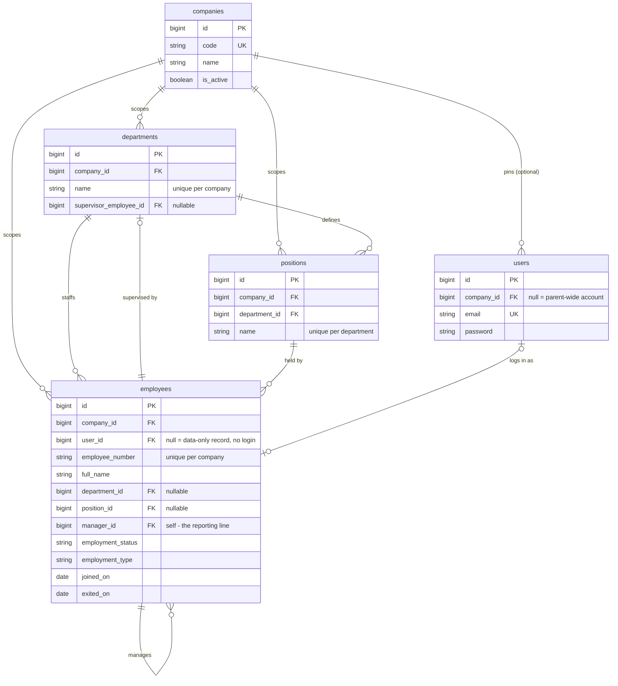
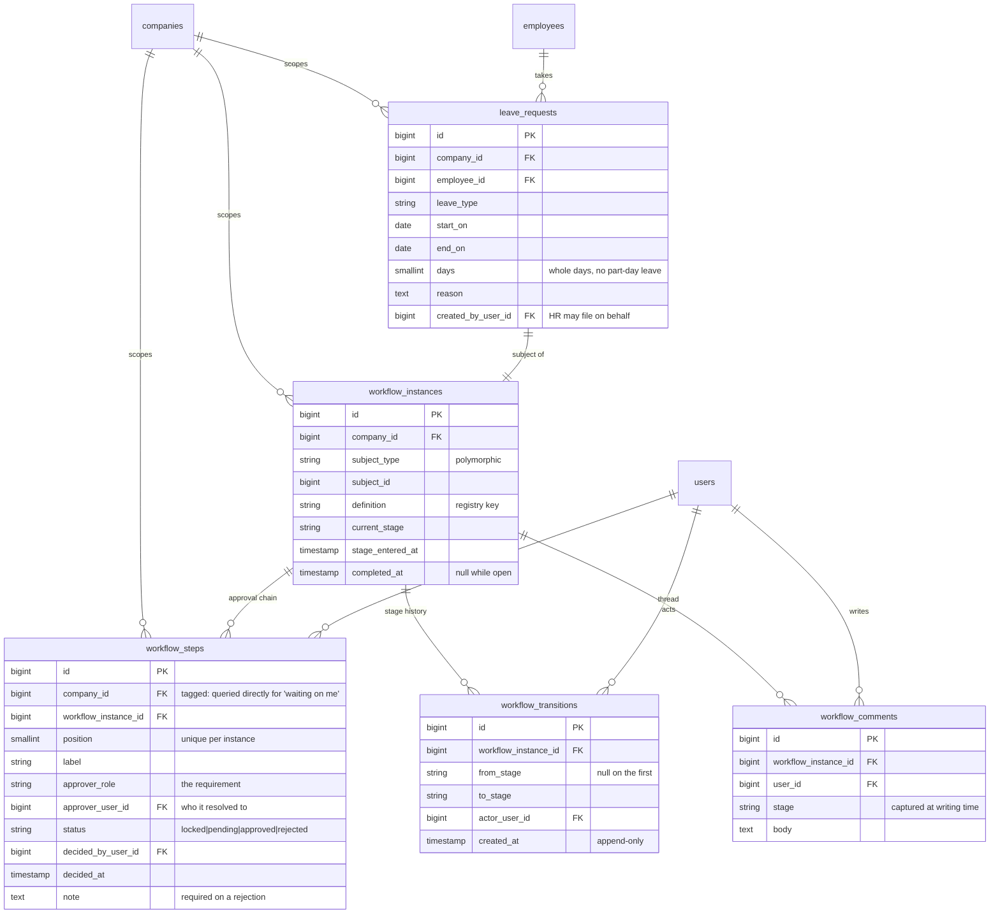

# HR Dashboard: development notes and change log

How to deploy and how the application is structured is in [README.md](README.md). This file keeps everything else:
the change log, the phase-by-phase checklist, decisions and their reasons, design rules and known gaps.

Internal HR application for a parent group of three operating companies: one dashboard for HR
and management, and (later) a PWA for staff. Replaces a fragmented Access + Excel + PDF setup
with a single source of truth.

**Two entrances, decided 2026-10-19** (replaces "private by design"). Elevated roles (supervisors and anyone
with direct reports, department heads, approvers, checklist item owners, Management, HR, admins) and the
scanner server reach the app over **WireGuard only** (Tailscale is not used). Employees reach their own
self-service pages over a **public entrance with no VPN**; elevated accounts that sign in there get the
same limited view. Not built yet: see Phase 6b. The careers intake on the existing CMP website remains
public, and the app talks to it outbound only.

The full spec lives outside this repo in `../docs/`:

| Document                                                | What it is                                                         |
| ------------------------------------------------------- | ------------------------------------------------------------------ |
| `../docs/context.md`                                    | The living spec: scope, architecture, decisions, process flows     |
| `../docs/HR_Dashboard_Features_and_Test_Scenarios.xlsx` | **Master** screen / feature / test list — 59 screens, 339 feature rows (10 of them removed, see `ATT-LVE`), 281 test cases |
| `../docs/dev-concepts.md`                               | Learning log: one entry per Laravel concept this app uses, and why |
| `../ATTENDANCE-SYNC.md`                                 | The Fingerspot scanner pipeline design and probe runbook           |

Where this README and the workbook disagree on feature detail, **the workbook wins**. This file
tracks structure and progress; the workbook tracks requirements and tests.

---

## Status

Phases 0 and 1 are largely done and Phase 2 (attendance) is mostly built; what remains in them is
listed in the checklist below. Nothing here is committed yet: changes are left for review.

|                 |                                                                                                              |
| --------------- | ------------------------------------------------------------------------------------------------------------ |
| Tests           | 705 passing                                                                                                  |
| Static analysis | PHPStan level 7, 0 errors                                                                                    |
| Phase 0         | **Complete** — company scoping, RBAC, workflow engine, account state and login rules                         |
| Phase 1         | Directory (with CSV import/export), profile, add/edit, documents, admin panel done                           |
| Phase 2         | Scan-log import, ingest API + agents, calendar, holidays/events, recap/export, issues, timesheet corrections |
| Phase 3         | Pengajuan end to end (types, timeframe, attachments, queue with filters/export/badge), leave on the calendar's side panel, in-app notices |
| Not built       | Recruitment and offboarding screens; employee app, on-site sync agent                                |

---

## Stack

| Layer                       | Choice                                                                                                                                                        |
| --------------------------- | ------------------------------------------------------------------------------------------------------------------------------------------------------------- |
| Framework                   | Laravel 13 (PHP 8.4), single monolith                                                                                                                         |
| Designed screens            | Inertia v3 + React 19 + TypeScript, Tailwind 4                                                                                                                |
| Admin / back-office screens | Filament 5 — panel at `/admin`: companies, users, role permissions                                                                                            |
| Database                    | PostgreSQL 16 (Docker, port 5434 locally)                                                                                                                     |
| Auth                        | Laravel Fortify — session login, 2FA, password reset, email verification. Registration is **not** enabled, which matches the spec: accounts are created by HR |
| Roles                       | spatie/laravel-permission (`teams` feature deliberately **off**)                                                                                              |
| Audit                       | spatie/laravel-activitylog                                                                                                                                    |
| Routes → TypeScript         | Laravel Wayfinder                                                                                                                                             |
| Tests                       | Pest (SQLite in-memory)                                                                                                                                       |
| Background work             | Database queue driver — no Redis                                                                                                                              |
| Local environment           | Docker Compose: `app` + `queue` + `vite` + `db`. Host PHP/Node optional                                                                                       |

---

## Change log (latest first)

- **2026-10-26 (attendance tables on a phone).** The mobile pattern already used for Pengajuan, the directory and profile
  changes, applied to the attendance screens: below `md` the wide table gives way to cards, and the filter row to one
  **Cari & filter** button opening a bottom sheet (`FilterSheet`; new `ChipMultiSelect` for the multi-select ones).
  - **Rekap absensi:** cards lead with the deduction and Alpa / Izin / Sakit / Telat, fold the other figures under
    "Rincian lain", with a total card first; the four cuts are a segmented row; Excel / CSV / print sit in an overflow menu.
    Print keeps the full table.
  - **Masalah absensi:** one card per issue (checkbox, type, detail, actions); the type/Cabang/department filters are in the
    sheet; the "excuse" bar is pinned above the tab bar.
  - **Data absensi** (waiting IDs with the mapping form, ID mappings, import history, rekap history) and the **rekap
    preview** lines are cards too. Front end only.

- **2026-10-26 (recap download as Excel).** `?export=xlsx` on the recap streams a workbook from `RecapWorkbook`
  (PhpSpreadsheet, already installed through Laravel Excel): one sheet per cut, a dark bold header, borders, frozen header
  and filter, bold total line, real numbers, and the deduction formatted `#,##0` so Excel groups thousands by the reader's
  locale. Every cell is written with an explicit type, so a name starting with `=` stays text. The screen's button is now
  **Unduh Excel**, with the plain `CSV` (`?export=csv`, raw numbers, unchanged) beside it.

- **2026-10-26 (one import page with two tabs, plan step 6).** `attendance/device.tsx` (Data absensi) now has a tab per
  upload: **Laporan Absensi (pemindai)** (status, agents when enabled, upload, IDs waiting, ID mappings, history) and
  **Rekapitulasi cabang** (Cabang that send one, upload, history, with the number of drafts on the tab). `?tab=rekap`
  opens the second one; the preview page's breadcrumb and a discarded draft return there. Front end only, no new route.
  This finishes the 6-step attendance plan of 2026-10-26.

- **2026-10-26 (recap with Alpa, Izin, Sakit, Telat, Zona, Potongan, plan step 5).** No migration. The recap keeps its free
  date range and its four cuts (employee, period, Cabang, department); every line gains `alpa`, `izin`, `sakit`, `telat`,
  `otherLeave` and `potongan`, and an employee line `zona`, `source` and `rekapMissing`.
  - Source follows the employee's Cabang `attendance_source`. **Scanner:** Alpa = an absent day, Telat = a late day, and an
    approved leave day is Izin, Sakit or other by the request kind's `absence_kind` (`DailyAttendance` now carries
    `leaveKind` per day; two leaves on a day count as the heavier, sakit over izin over none). Deduction =
    `PotonganCalculator::forRow` with the profile's Zona and position. **Rekap:** the sum of matched lines of **confirmed**
    files whose period lies **wholly inside** the range (the file's own `computed_potongan`); a file that only partly
    overlaps is not counted and comes back in `rekapNotes` for a banner, since its counts cannot be cut by date. A rekap
    Cabang with no file in range shows dashes (`rekapMissing`), and its day-derived columns are dashes too.
  - The per-period cut and the Cabang/department/grand totals add the new figures; rekap people are left out of the
    per-period cut (no days). CSV appends `Alpa, Izin, Sakit, Telat, Potongan (Rp), Zona, Sumber` after the old columns.
  - Screen columns: Zona, Hadir, Alpa, Izin, Sakit, Telat, Potongan, Pulang cepat, Cuti lain, Belum ada data, Jam kerja
    ("Terlambat" and "Tidak hadir" are now Telat and Alpa).

- **2026-10-26 (branch rekapitulasi import, plan step 4).** Migration `create_attendance_rekaps_tables`:
  `attendance_rekaps` (Cabang, dates, `status` draft | confirmed | superseded) and `attendance_rekap_rows` (the
  counts, `file_potongan`, the app's `computed_potongan`, `match_status` from `RekapMatch`).
  - `RekapParser` finds columns by their headings (NAMA, JABATAN, ZONA, ALPA, IZIN, SAKIT, TELAT, TOTAL POTONGAN) and the
    dates from the "21/09/2026 s.d 20/10/2026" cell, falling back to the month in Periode. A non-whole count fails the
    upload with its row number. Fixture: `tests/Fixtures/rekap-cabang.xls`.
  - `ImportRekap` stores a **draft** and matches NAMA to employees **of the chosen Cabang only** (case and punctuation
    ignored; one active match = matched, none = unmatched, several = ambiguous; one employee is never tied to two lines).
    Linking **by hand** offers everyone in the Cabang's company (the Cabang's own people first, others with the Cabang
    they are filed under), because a name nobody in the Cabang has is usually a profile still filed under another one.
    `ConfirmRekap` refuses while a line is unmatched or ambiguous, then replaces a confirmed file for the same Cabang
    and dates. Overlapping other dates are warned about, not blocked.
  - `PotonganCalculator` + `attendance.potongan` in config: rate by Zona x (Alpa + Izin) + half the rate x Telat; Sakit
    free; position exactly `SUPERVISOR` or a Periode mentioning `SETAHUN` is exempt. The employee's profile Zona is used;
    the file's Zona and TOTAL POTONGAN are only compared against it and flagged in the preview (the app's figure wins).
  - UI: "Unggah rekapitulasi cabang" card on the data page (only Cabang whose Sumber absensi is Rekapitulasi), preview at
    `attendance/rekaps/{id}`. Step 5 reads confirmed rekaps; step 6 puts both uploads on one page with two tabs.

- **2026-10-26 (absence tags, plan step 3).** Migration `add_attendance_source_zona_and_absence_kind`:
  `branches.attendance_source` (`scanner` default | `rekap`, `AttendanceSource`), `employees.zona` (`hijau` default |
  `merah` | `hitam`, `Zona`, optional on the form), `request_types.absence_kind` (`none` | `izin` | `sakit`,
  `AbsenceKind`; `sick` backfilled to `sakit`).
  - Sakit: needs an attachment (`checkSakitAttachment`), needs `max_back_days` on the type, and its approval chain is the
    HR Admin role, not the Atasan (`SubmitLeaveRequest::chain`). Approved leave already outranks an absent day, so Alpa
    becomes leave; step 5 splits leave into izin/sakit/other with `absence_kind`.
  - `BranchPolicy`: whoever holds `manage-attendance-device` may open and edit a Cabang (the name is read-only to them);
    create and delete stay with `manage-companies`.

- **2026-10-26 (attendance by manual import).** Capture is now manual: head office imports the Fingerspot export, other
  Cabang will send a per-period rekap (import still to come).
  - Scanner import reads the Fingerspot "export laporan" as is: `.xls`/`.xlsx` (Laravel Excel, which needs `gd` in the
    image) or CSV, HTML saved as `.xls`, header found below title rows, "Tanggal scan" as the date-time, "I/O". The SN is
    optional when the file has one. An unmapped PIN is mapped to the one employee whose number equals its NIP
    (`attendance_imports.auto_mapped`). Fixtures: `tests/Fixtures/fingerspot-export.xlsx`, `rekap-cabang.xls`.
  - `FEATURE_ATTENDANCE_AGENTS` (default **off**) hides the sync agents without deleting them: ingest API and "sync now"
    404, admin screens closed, agent card and warning gone (`AttendanceFeatureSwitchTest`).

- **2026-10-21 (deployment readiness).**
  - `SystemAdminSeeder`: a real server's `db:seed` creates the roles and one company-less System Admin from
    `INITIAL_ADMIN_*` (`config/initial_admin.php`), and no placeholder companies (`SystemAdminSeederTest`).
  - `FEATURE_ATTENDANCE` switch (`config/features.php`, `EnsureFeatureEnabled`, `Features`): the attendance pages, ingest API,
    profile tab, dashboard card, admin screens and the 09:00 notice are off; the calendar and holidays stay because leave day
    counts need them (`AttendanceFeatureSwitchTest`). Leftovers while it is off: the calendar grid still uses attendance
    wording with no data behind it, and the employee drawer and global search were not checked.
  - `docker/server/nginx.conf.template` takes the visitor's real address from `X-Forwarded-For`, only from the three Docker
    gateway addresses, so a TLS proxy on the host does not make the public look private. **Not yet tested on a server.**
  - README split: deployment and structure stay in `README.md`; this file holds the notes.
  - **On-site sync agent built** in the separate `fingerspot-toolkit` project (`scripts/sync-agent.ps1`, follow-ups F10 and F11
    in its README): reads the listener's CSV, posts to `POST /api/ingest/attendance` through a WireGuard peer, handles 422 by
    splitting the batch, keeps its position, heartbeats. Tested only against a stand-in for the ingest; **not yet against the
    real dashboard or the tunnel**, and it needs `FEATURE_ATTENDANCE=true` (the agent screen is hidden and the ingest is 404 while off).
    Also open: peers of the dashboard's WireGuard server are not isolated from each other (a firewall rule on the VPS is
    needed so a staff peer cannot reach the SERVER-CAMAT peer; the compose file does not set one).
    Still open: the scanner's acknowledgement (toolkit F2), the PIN to employee mapping (a CSV import for mappings is parked),
    and what verify modes 20 and 30 are called in the scanner's JSON.
  - Not run when these were written (no PHP or Docker on that machine): the new tests, `pint`, the frontend type-check and build.
- Earlier changes are recorded per screen in the checklist below ("Built 10-15", "Since 10-14", and so on).

The quick start, seeded logins and checks are in [README.md](README.md). What follows is why things are the way they are.

## Local development notes

### Why pages are as fast as they are (and what is still slow)

A page load on the Windows bind mount was taking about **3.4 seconds**, almost all of it booting
the framework rather than running the page. It is now about **0.8–1.1 seconds**. What was done,
so it is not undone by accident:

- **The admin panel's resources are registered only where the panel is served**
  (`AdminPanelProvider::resources()`), not on every request. Filament registers panels when the
  app boots, so every page — including ones with nothing to do with the panel — was paying about
  0.7s for six resources. They are listed explicitly rather than discovered (discovery scans
  folders on every request). **A new Filament resource must be added to that list.**
- **The sidebar's admin-panel check is `User::canAccessAdminPanel()`**, which does not need
  Filament loaded.
- **The queue worker is `queue:work`, not `queue:listen`.** `listen` re-boots the whole
  framework on every poll and held a core at 50% doing nothing.
- **Vite polls every 1000ms, not 300ms**, which had kept another core busy.

Still slow, and not fixed here: the code lives on a Windows bind mount, so every config, route
and class file is read across it. Two things would help further and were deliberately not done:
caching config (`php artisan config:cache`) is unsafe with this test setup, because a cached
config ignores `phpunit.xml` and the suite would run against the development database; and
moving the repository into the WSL2 filesystem would remove the bind-mount cost altogether.

### Why the compose file looks the way it does

Seven decisions that are load-bearing — changing them reintroduces bugs that were genuinely
painful to diagnose:

- **`vendor/` and `node_modules/` live in named volumes, not the bind mount.** `vendor/` is
  ~10k files; serving it from the Windows host made a bare framework boot take **6–15 seconds**
  and page renders time out entirely. In a named volume the same request takes **~0.2s**. Your
  source files stay bind-mounted and live-editable, and the host keeps its own `vendor/` on
  disk for IDE intellisense — the volume only shadows it inside the container.
- **Compose sets only `DB_HOST` and `DB_PORT`, never `DB_CONNECTION` or `DB_DATABASE`.**
  Compose variables also land in `$_SERVER`; Laravel's `env()` reads `$_SERVER` before `$_ENV`;
  and `phpunit.xml`'s `force="true"` cannot reach `$_SERVER`. Setting them here makes
  `php artisan test` run against the **development database**, and `RefreshDatabase` wipes it.
  It did, twice, before this was understood.
- **Node ships inside the PHP image.** The Wayfinder Vite plugin shells out to
  `php artisan wayfinder:generate` whenever the dev server starts, so a Node-only container
  cannot run Vite at all. One image, two services.
- **`artisan serve` runs with `--no-reload`.** Without it `PHP_CLI_SERVER_WORKERS` is ignored
  and the dev server handles one request at a time. It only disables restart-on-`.env`-change,
  not picking up code edits.
- **The two projects must stay siblings.** The Vite config reaches the backend as `../backend`
  (for `artisan`, `public/`, and the route files it watches), and the containers mount them at
  `/var/www/backend` and `/var/www/frontend` to match. Moving either breaks the build.
- **The container entrypoint prepares the backend in a subshell.** Every service shares it, but
  the `vite` service runs from `frontend/`; if the script `cd`'d into the backend and stayed
  there, Vite would start in the wrong directory.
- **`@/` is defined in `vite.config.ts`, not just `tsconfig.json`.** See the note under *Where
  things live*; without it every `@/` import fails to resolve and the page is blank.

Also: `vite.config.ts` sets `server.origin` from `VITE_DEV_SERVER_URL`, because
laravel-vite-plugin writes that value verbatim into `backend/public/hot` and the browser —
outside the container — must be able to reach it. And `build.emptyOutDir` is on, because the
build output (`backend/public/build`) sits outside the frontend's root and Vite will not clean
a folder it does not own unless told it may.

**Inertia SSR is off in the container** (`INERTIA_SSR_ENABLED=false`). In dev it makes every
page render a second round trip into the Vite container for no local benefit. To exercise it,
flip that to `"true"`; `INERTIA_SSR_HOT_URL` is already set so the cross-container call works.
Production keeps SSR on.

## Where things live

The repository holds **two projects side by side**. They are still joined at runtime — the
backend renders pages with Inertia and serves the frontend's build — but they are separate
folders with their own dependencies, configs and tooling.

```
hr-application/
├── backend/              the Laravel app — PHP, Composer, PostgreSQL
├── frontend/             the React app — Node, Vite, TypeScript, Tailwind
├── docker/               PHP config + the container entrypoint
├── Dockerfile            one image (PHP + Node) used by every service
├── docker-compose.yml    db · app · queue · vite
└── README.md
```

The two meet in exactly four places. Anything else crossing the boundary is a bug.

| Seam | Where | What it does |
|---|---|---|
| Pages | `frontend/src/pages` ← `backend/config/inertia.php` | Inertia resolves a component name to a file here, and the test helper checks it exists |
| Built assets | `frontend/` → `backend/public/build` | `vite build` writes the bundle where Laravel serves it from |
| Dev hot file | `frontend/` → `backend/public/hot` | tells Laravel where the Vite dev server is |
| Typed routes | `backend/routes` + `app/**/Http` → `frontend/src/{actions,routes,wayfinder}` | Wayfinder generates TypeScript from the Laravel routes. **Generated; never edit, never commit** |

### Backend

Only the parts worth knowing. Framework scaffolding is omitted.

```
backend/
├── app/
│   ├── Concerns/
│   │   └── BelongsToCompany.php      every company-tagged model uses this, and only this
│   ├── Enums/
│   │   ├── EmploymentStatus.php      active | inactive
│   │   ├── EmploymentType.php        permanent | contract | probation | intern
│   │   ├── LeaveRequestStage.php     a WorkflowStage implementation
│   │   ├── LeaveType.php             the six leave types
│   │   ├── OffboardingCaseStage.php  a WorkflowStage implementation
│   │   ├── Permission.php            the permission vocabulary
│   │   ├── Role.php                  the 5 roles + the role → permission mapping
│   │   └── WorkflowStepStatus.php    locked | pending | approved | rejected
│   ├── Http/
│   │   ├── Controllers/              Employee, LeaveRequest, LeaveRequestDecision, CompanySwitcher
│   │   ├── Middleware/SetActiveCompany.php   resolves the active company, before Inertia shares it
│   │   └── Requests/                 validation + authorisation, one class per form
│   ├── Models/                       Company, Department, Position, Employee, User,
│   │   │                             LeaveRequest, Workflow{Instance,Step,Transition,Comment}
│   │   └── Scopes/CompanyScope.php   the tenancy filter
│   ├── Policies/                     one per model
│   ├── Support/                      CompanyContext (the active company), ReportingLine (downline)
│   ├── Actions/Leave/                SubmitLeaveRequest — builds the approval chain
│   ├── Listeners/LogRoleChange.php   audits role grants and revokes
│   └── Workflows/                    the approval engine (see "The three foundations")
├── config/                           inertia.php points page lookup at ../frontend
├── database/                         migrations · factories · seeders (DevAccountSeeder is local-only)
├── resources/views/app.blade.php     the thin Blade shell Inertia mounts into
├── routes/                           web.php · settings.php
├── tests/                            Pest — Feature, Unit, and a Fixtures/ subject for the engine
├── composer.json  phpunit.xml  phpstan.neon  pint.json
└── .env                              git-ignored; copied from .env.example on first run
```

### Frontend

```
frontend/
├── src/
│   ├── app.tsx                 Inertia entry point and layout resolution
│   ├── css/app.css             Tailwind entry, theme variables
│   ├── pages/                  one component per screen, mirroring the Laravel route names
│   ├── layouts/                app (sidebar/header), auth, settings
│   ├── components/             company-switcher, employee-form, leave-decision-dialog, …
│   │   └── ui/                 shadcn primitives — do not edit
│   ├── hooks/  lib/  types/    types/ holds the hand-written view models (employee, leave, company)
│   └── actions/ routes/ wayfinder/    GENERATED by Wayfinder
├── package.json  vite.config.ts  tsconfig.json  components.json
└── .gitignore                  ignores node_modules and the generated folders above
```

`@/` means `frontend/src/`. It is defined in `vite.config.ts` — `laravel-vite-plugin` ships a
default of `/resources/js`, which no longer exists, and `tsconfig.json`'s `paths` is only read by
the editor and `tsc`, not by Vite.

---

## Data model

Derived from the migrations and the model relationships as they stand.

### Core: companies, org chart, accounts



Three things in that diagram carry most of the design:

- **`company_id` is everywhere.** It is the tenancy key; `CompanyScope` filters every query by
  it. See _Company scoping_ below.
- **`users.company_id` is nullable, and null means parent-wide** — an account that may switch
  companies or view them combined. Every other account is locked to one.
- **`employees.user_id` is nullable.** Warehouse staff exist as dossier records with no login,
  so they are never actors or approvers.

`employees` also carries the four dossier card groups from the design (`EMP-DET`): contact +
emergency contact, bank and tax, payroll, and health and insurance — 23 nullable columns left
off the diagram to keep it readable. **Money is integer rupiah** (`base_salary_idr` and
friends), never a float.

### The approval workflow engine



`subject_type` / `subject_id` is polymorphic and unique together: any model can be a workflow
subject, and runs through one workflow at a time. No module uses it yet.

### Framework- and package-owned tables

Not ours to design, listed so the diagrams above read as complete:

`users` extras from Fortify (`two_factor_*`), `password_reset_tokens`, `sessions`, and
`passkeys` — which exists from a shipped migration but is **unused**, since the passkey feature
is not enabled ·
`roles`, `permissions`, `model_has_roles`, `model_has_permissions`, `role_has_permissions`
(spatie/permission) · `activity_log` (spatie/activitylog) · `cache`, `cache_locks`, `jobs`,
`job_batches`, `failed_jobs`, `migrations`.

---

## The three foundations

These are the XXL items the spec says to get right first, because retrofitting any of them
means reopening every module. Full reasoning in `../docs/context.md` §13.

### 1. Company scoping

One database, three companies, strict separation. Four pieces:

| File                                       | Job                                                                                                                            |
| ------------------------------------------ | ------------------------------------------------------------------------------------------------------------------------------ |
| `backend/app/Concerns/BelongsToCompany.php`        | Apply this trait and nothing else. Registers the scope, fills `company_id` on create, provides the `acrossCompanies()` bypass. |
| `backend/app/Models/Scopes/CompanyScope.php`       | Filters every query on a tagged model.                                                                                         |
| `backend/app/Support/CompanyContext.php`           | Holds the active company for the request.                                                                                      |
| `backend/app/Http/Middleware/SetActiveCompany.php` | Resolves it **from the user's record, never from request input**.                                                              |

`CompanyContext` has **three states, and the difference matters**:

- **constrained** — one company selected, filter on;
- **combined** — a parent-wide role deliberately viewing all three, no filter;
- **unresolved** — console, queue, tests: no filter, because there is no user to scope to.

Only the first filters. Code that runs unresolved **must scope its own queries** — a console
command cannot assume the scope protects it. The deliberate bypass is `acrossCompanies()`;
authorise the caller before using it.

### 2. RBAC

Roles and permissions are **enums**, not strings, and the role → permission mapping lives on
`Role::permissions()`. That mapping is only the **starting point**: `RoleSeeder` creates a role
with its defaults and then never touches it again, so what a role may do is managed from the
admin panel (`/admin/roles`) and survives re-seeding. The cost is that a permission added to
the enum later reaches new installs only — grant it to existing roles from the panel.

| Role                    | Holds                                                 |
| ----------------------- | ----------------------------------------------------- |
| System Admin            | accounts, roles, companies, org — **not** the dossier |
| HR Admin                | the dossier, documents, sensitive data and attendance data + org — **not** accounts or roles |
| Management / Supervisor | view employees only (no documents, bank, payroll or health) |
| Employee                | nothing; sees their own record via policy             |

**Changed 2026-10-14:** `view-employees` used to show Supervisor and Management the whole company.
It now opens the directory only; who appears is decided by the reporting line (`manager_id`), not the
role: everyone sees themselves and their whole downline, nobody above or beside them, and anyone
with people reporting to them gets the directory without any role. Seeing the whole company is the
separate `view-all-employees` permission, held by HR Admin, System Admin and Management by default
(a migration granted it to existing roles; Supervisor does not have it). The scope is
`Employee::visibleTo($user)`, `LeaveRequest::visibleTo($user)` and `ReportingLine::visibleIds()`, and
covers the directory (list, grid, chart, export), search, the profile, drawer and Tim tab, the
Pengajuan queue and the department / position filters.

Policies re-check the company even though `CompanyScope` already filters, because a model
fetched via `acrossCompanies()` or resolved in a console context has not been filtered.
`UserPolicy` has **no such safety net** — `User` is not company-tagged, since a parent-wide
account has no company — so its company comparison is the only separation there is.

spatie's `teams` feature is **off**. Tenancy here is `CompanyScope`; enabling teams would give
two competing mechanisms for one job.

### 3. The approval workflow engine

Shared by Requests, Recruitment and Offboarding so they cannot drift into three different
notions of "approved". A module supplies a stage enum and a `WorkflowDefinition`; the engine
supplies the four tables and `WorkflowEngine`, which is the only way any of it changes. Every
write is one transaction.

Decisions you will trip over otherwise:

- **An unconfigured chain blocks a gated stage.** "No approvals required" and "approvals not
  set up yet" look identical to a naive guard, and only one is safe to let through.
- **A resolved approver is binding.** Once a step names a person, only that person decides it —
  holding the same role is not enough.
- **A rejection stops the chain** rather than opening the next step, and requires a reason.
- **Two kinds of refusal.** `InvalidTransition` = the definition forbids the move, i.e. a bug
  the UI should not have offered. `TransitionBlocked` = legal but a guard refuses now, i.e.
  ordinary, so it carries messages. `blockingReasons()` is public and separate so a screen can
  disable an action _and say why_.

Originally planned on spatie/laravel-model-states; dropped 2026-10-05 — reasoning in
`../docs/context.md` §5.3 and §13.2.

---

## Conventions

- **Never register `CompanyScope` by hand** and never hand-write `where('company_id', …)` on a
  tagged model. The trait is the whole contract.
- **Use the enums.** `Role`, `Permission`, `EmploymentStatus`, `WorkflowStepStatus`. `User::isA(Role)`
  exists so a typo is a type error rather than a check that quietly returns false.
- **Pages never wrap themselves in `<AppLayout>`.** `app.tsx` already applies it to every
  non-auth page, so wrapping again renders the sidebar and header twice. A page returns plain
  content and declares `Page.layout = { breadcrumbs }`; breadcrumbs that depend on props use
  `setLayoutProps({ breadcrumbs })` instead (see `frontend/src/pages/employees/show.tsx`).
- **Money, when it arrives, is integer rupiah.** No floats.
- **UI text is Indonesian**, held in translation files so English can be added later.
- **PHPStan runs at level 7**, which means every Eloquent relation needs its generics:
  `@return BelongsTo<Company, $this>`. It is not optional and it has caught real bugs.
- **Model attributes use PHP attributes**, matching the starter kit: `#[Fillable([...])]`,
  `#[Hidden([...])]`, and a `casts()` method.
- **Dates are `CarbonImmutable`** (set in `AppServiceProvider`).
- **Tests run on SQLite in memory**, not Postgres. Anything relying on Postgres-specific
  behaviour needs checking against the real database too.

---

## Development checklist

59 screens from the workbook, grouped into phases. **The workbook is the master** — it holds
the 339 feature rows, their sizes and priorities, and the 281 test cases. This table is the map.
The access, registration, profile-change and backdating rules decided on 2026-10-14 are summarised
under [Decided 2026-10-14, not built yet](#decided-2026-10-14-not-built-yet) below; the rows they
reopen are marked 🟡 with "→ 10-14".

`f` = feature count · `P1` = must-have count · status: ✅ done · 🟡 partial · ⬜ not started · ➖ removed (folded into another screen)

### Phase 0 — Foundations ✅

| Screen     | Name                          | f   | P1  | Status | Notes                                                                                                                                                                                                                                                         |
| ---------- | ----------------------------- | --- | --- | ------ | ------------------------------------------------------------------------------------------------------------------------------------------------------------------------------------------------------------------------------------------------------------- |
| `CORE-NAV` | Company switcher              | 4   | 3   | ✅     | Scoping + switcher + server-side lock                                                                                                                                                                                                                         |
| `CORE-RBA` | Role & permission enforcement | 8   | 7   | ✅     | Roles, permissions, policies, reporting-line downline resolver (004), role-change audit (007). Since 10-14: visibility is scoped to the downline everywhere (004) and `view-all-employees` lifts it (008)                                                     |
| `CORE-WFL` | Approval workflow engine      | 9   | 7   | ✅     | All nine, including acting on an approval over HTTP (009). The "or app" half waits on the PWA                                                                                                                                                                 |
| `CORE-AUT` | Login & session               | 8   | 8   | 🟡     | Session login + 2FA (001), employee-ID login (002), temporary passwords forced to change (003), admin reset (004), idle expiry = `SESSION_LIFETIME`, 120 min (005), session/token revocation (006), failed-login throttling (007). Missing: scoped employee-app tokens (008) — waits on the employee app. Since 10-14: the temporary-password account (003) is the fallback; staff register themselves (`CORE-REG`) |
| `CORE-REG` | Account registration (Daftar) | 5   | 3   | ✅     | Built 10-14. NIK + employee ID + password (+ optional email) activates the account for a profile HR created; the same refusal message for every failure; 5 attempts a minute per address; the registration is on the audit trail with the address. The rest of this row's detail is under "Decided 2026-10-14" |

### Phase 1 — Employee dossier & admin screens

| Screen     | Name                                   | f   | P1  | Status | Notes                                                                                                                                                 |
| ---------- | -------------------------------------- | --- | --- | ------ | ----------------------------------------------------------------------------------------------------------------------------------------------------- |
| `EMP-DIR`  | Employee directory (list)              | 12  | 12  | ✅     | Search, department/position multi-select, status chips, sort, active-filter strip, row summary, CSV import (010) and CSV export of the filtered list (011). Since 10-14: list, grid, chart and export are limited to the downline; NIK is a required import column; records without an account read "Belum terdaftar" (008) |
| `EMP-GRD`  | Directory — grid view                  | 1   | 1   | ✅     | A view over the same filtered query; each card shows the profile picture, or initials |
| `EMP-CHT`  | Directory — org chart                  | 1   | 1   | ✅     | A top-down tree drawn from `manager_id` with connector lines; anyone whose manager is filtered out renders as a root |
| `EMP-ADD`  | Add / edit employee                    | 6   | 6   | ✅     | One form for both. Self-referencing manager refused; company filled from the active company. Since 10-14: NIK is required (16 digits) and unique across the group (002); HR does not create logins (005) |
| `EMP-PRF`  | Profile shell                          | 3   | 2   | 🟡     | Header stats + tabs (Overview, Absensi, Pengajuan, Dokumen, Tim). Opens as a side drawer from the directory. Change audit is on (003); "SOPs to acknowledge" stays dropped with the Knowledge Hub. **→ 10-14:** the Tim tab shows only people inside the viewer's scope (002) |
| `EMP-CHG`  | Profile change requests                | 6   | 5   | ✅     | Built 10-14. The employee proposes changes to the self-service fields (`ProfileChangeRequest::FIELDS`); HR reviews the changed fields as now → asked, approves or rejects with a reason; one open request at a time; a field HR changed meanwhile is not overwritten; HR's own edits apply directly, but nobody edits their own record, so an HR Admin's own changes need another HR Admin |
| `EMP-DET`  | Profile — overview tab                 | 6   | 5   | ✅     | All five card groups render; bank, payroll and health are withheld from roles without `view-sensitive-data` (006) |
| `EMP-DOC`  | Profile — documents tab                | 4   | 2   | ✅     | Upload, categorise, version, expiry flags and per-document restriction. Reminders are in-app only — see Known gaps |
| `EMP-ATT`  | Profile — attendance tab               | 3   | 3   | ✅     | Timesheet (month and year), manual add/change/void with reason + audit, recompute, and totals by employee, department and period (the recap) |
| `EMP-REQ`  | Profile — requests tab                 | 2   | 2   | ✅     | Real: lists the employee's leave requests and leave taken this year                                                                                   |
| `CORE-USR` | User & role management                 | 7   | 6   | 🟡     | Policies and Filament screens (users, roles, permissions); activate/deactivate, last login, temporary password, reset password and revoke sessions per user. Since 10-21 a real server's first run seeds one company-less System Admin (`SystemAdminSeeder`, from `INITIAL_ADMIN_*`) who creates the companies and each company's first HR Admin in the panel. **Open:** the Management accounts still need the client's details (007) |
| `CORE-ORG` | Departments, positions, reporting line | 4   | 4   | ✅     | Schema, policies, the downline resolver and Filament screens for departments and positions                                                                         |
| `CORE-ADM` | Company settings                       | 1   | 0   | 🟡     | Filament company screen done                                                                                                                                |

### Phase 2 — Attendance

Sync first: it is the prerequisite for any real attendance data, and the on-site probe has
**not been run yet** (`../ATTENDANCE-SYNC.md`). Until it is, the log is captured by hand: someone
runs Personnel's **Download ScanLog** at the end of each working day and loads the file at
`/attendance/device` ("Data absensi" in the sidebar). The scanner IDs are matched to employees
there too.

How the import behaves, so it is not surprised by:

- **Idempotent.** Punches are de-duplicated on (device serial, scan time, PIN), the same key as
  Personnel's `att_log`. The same file twice, or two overlapping files, adds nothing the second
  time; the page reports "baru / duplikat / menunggu / ditolak" for every load.
- **Unmapped PINs are held, never dropped**, in `attendance_unmapped_punches`. Mapping the PIN
  moves its waiting punches into attendance in the same step. A PIN that equals exactly one
  employee number is offered as a suggestion.
- **Mappings can carry dates**, because scanners reuse PINs. The mapping in force on the day of
  the scan wins, judged in the scanner's timezone.
- **Times are interpreted in `ATTENDANCE_DEVICE_TIMEZONE`** (default `Asia/Jakarta`), because the
  scanner records local time with no zone. They are stored in UTC and shown back in the scanner's
  zone. Wrong zone, and every punch shifts by the difference.
- **"Data sampai" matters.** While capture is manual the data is only as fresh as the last
  upload, so nothing built on it may read the days after it as absence. The status shows
  Terkini / Terlambat against the previous working day, which skips weekends and any holiday or
  event that covers the whole group (one for a single company or department does not count, since
  the others still scan). The dashboard shows a card to the people who load the log, but only
  when something needs doing.
- **Open to parent-wide accounts holding `manage-attendance` only** (HR Admin by default). The
  scanner serves the whole group, so a company-pinned HR admin cannot load or map.
- **The file format is not verified.** Personnel's real export has not been inspected, so the
  parser reads a CSV header and recognises common column names (English and Indonesian) rather
  than one fixed layout. Needed: a PIN column and a date-time column (or separate date and time
  columns); optional: device serial, verify mode, in/out mode. Dates are read day-first. If a
  real export differs, adapt the alias lists in `App\Support\Attendance\ScanLogParser`.
  `backend/tests/Fixtures/scanlog-sample.csv` is a sample to try the page with (PINs 1001–1005
  and an unknown 9999).
- **The calendar (`/attendance/calendar`, "Kalender")** derives each person's day from the
  raw punches every time; nothing is stored, so a late upload or a corrected mapping changes it
  immediately. It needs the `view-attendance` permission (HR Admin by default) and follows the
  company switcher. The rules, in order, are in `DayClassifier`:
  1. a day after the last captured data is **no data**, never absence — except what is known in
     advance: a holiday is **off** and approved leave is **leave**, even in the future (leave
     shows on weekends too, matching the day count on the request);
  2. a holiday or event covering the person is **off**; a day nobody at all scanned on is also
     off, as a fallback for a holiday nobody entered;
  3. **approved leave beats a punch**: someone on approved leave is on leave whatever the scanner
     says, and the scan is raised as a "Scan saat cuti" issue rather than hidden;
  4. otherwise any punch makes the day present / late / early-leave, even on a weekend;
  5. otherwise approved leave is leave, and a non-workday is off;
  6. someone with **no scanner ID mapped** on that date is no data, not absent — nothing could
     have been recorded for them. Rows say "ID pemindai belum dipetakan".
  Only then is a workday with no scan an absence.
- **The Day view is a list, not a grid:** one row per person with Jabatan, Atasan, Masuk (first scan),
  Pulang (last scan, blank for a single scan) and a Status column (Hadir / Terlambat / Cuti …; a
  holiday shows its name). The date is not repeated as a column; it is in the toolbar.
- **Week, month and year are summaries, not grids of people.** Each answers how many came in and how
  many were late or away, at a different scale; clicking a day opens its Day view, where the people
  are listed (and a month opens from the year view).
  - **Week:** a bar per day (checked in, with the late share marked), the weekday average as the
    headline, weekends and holidays hatched.
  - **Month:** a Monday-first calendar of day tiles with the head count, "n cuti · m terlambat", the
    holiday's name, today outlined, and a flag when under 60% of the people expected came in.
  - **Year:** the attendance rate per month (under 90% highlighted, months with no data hatched), the
    year's rate as the headline, and a table per month of working days, leave days, late arrivals and
    unexplained absences with a total row.
  - **The rate is attended ÷ (attended + absent).** Approved leave counts neither for nor against, and
    a day or month the log has not reached shows "—", never 0%. The side panel uses the same
    definition. Leave, late and absent in the year table are person-days. The filters (department,
    team, leave type, status) apply to all of these, and the CSV export of the year view carries the
    rate and working days.
- **The calendar's side panel has one list of who is on leave** (`ATT-SID-004`..`006`): "Sedang cuti
  hari / minggu / bulan / tahun ini". It follows the view, so it is the day on Day, the week on Week, the
  month on Month and the year on Year, and moving to another day redraws it (when the range is not the
  current one the title names it, "Cuti · Senin, 12 Oktober 2026"). The rule is **at least one day**:
  anyone with a single day of approved leave inside the range appears, including leave that began
  before it or runs past it, and someone with several leaves is counted once. Pending and rejected
  requests are not listed. It is drawn from the same people as the grid, so department, team, search and
  status narrow it too, and a chosen request kind narrows the leave itself. It stops at 50 entries and
  says how many more. This replaced the separate "out today", "upcoming" and "waiting on you" panels
  (see the decision under "Known gaps").
- **Layouts are checked at phone width (390 px).** The header shows only the current page's name and a
  narrower company switcher; the profile's tabs wrap instead of running off screen; tables that scroll
  sideways keep their headings on one line, with the name column pinned on the recap; the calendar's
  Day view and the employee list drop their secondary columns (position and supervisor appear under the
  name); month tiles show the count (and "n cuti") and leave the rest to the Day view; and the issues
  screen becomes a list of cards. The dashboard's grey placeholder blocks are the starter kit's and
  are not real content.
- **An employee's Absensi tab has a Bulan / Tahun toggle.** Tahun is the whole year in one table: per
  month hadir, terlambat, pulang cepat, tidak hadir, cuti, working hours and the rate, with a total
  row and a bar per month; opening a month goes to its day-by-day timesheet. It is fetched the same
  way (`?period=year&year=YYYY` on the profile's partial reload).
- **Working hours are set in the admin panel** (`/admin`, "Jam kerja", parent-wide HR Admin
  only): start, end and the lateness tolerance in minutes. Nothing in the requirements defines
  them, so until someone saves their own, `config/attendance.php` supplies 08:00, 17:00 and 10
  minutes. They live in `app_settings` and apply at once; each change is on the audit trail.
  **Saturday and Sunday are fixed as non-working in code** and are deliberately not a setting.
  One schedule applies to everyone: shift work (a warehouse) would need one per employee or
  department. First scan is the check-in and last scan the check-out; the scanner's in/out flag is
  not trusted. A day with a single scan is never judged an early departure.
- **The profile's attendance tab** (`EMP-ATT`) is sent only when opened (an Inertia optional prop,
  fetched by a partial reload), so the profile does not pay for a month of scans on every visit.
  It shows each day's status, first/last scan and duration, plus the scans behind them. People
  with `correct-attendance` (HR Admin) can add a scan, change a time, or void a scan, each with a
  mandatory reason. **The punch log stays append-only**: a voided scan is kept, struck through
  with who voided it and why, and everything derived ignores it; a changed time is a void plus a
  new `manual` punch. All of it is on the audit trail. An employee sees their own timesheet but
  cannot correct it.
- **Issues** (`/attendance/issues`, "Masalah absensi") are never stored: they are read off the same
  derived days as the calendar, so correcting a scan or approving leave makes one disappear. Six
  kinds: late, early leave, no check-out (a single scan on a day that is over), absent without
  approved leave, doubled scans (two within 2 minutes), and a scan on a day of approved leave (on leave
  the day is leave and nothing else is raised for it). Only the decision to **excuse** one is
  stored (`attendance_issue_resolutions`), with a mandatory reason and who made it, and it can be
  reopened. Excusing is bulk-capable and refused for the whole batch if any employee is outside
  the user's reach. Ranges are capped at 62 days.
- **Holidays and events** (`ATT-WIZ`, the "Hari libur & acara" card on the calendar) are stored in
  `calendar_events`, each for the whole group, one company, or one department, up to 31 days. They
  need `manage-calendar-events` (HR Admin by default); a company-pinned admin can only add for
  their own company and can only delete their own company's. Everything is on the audit trail.
- **Recap and export.** `/attendance/recap` ("Rekap absensi") totals each person's statuses over
  a range of up to 366 days, with the same department/team/leave-type filters, `?export=csv`, and
  a print layout (browser "save as PDF"; no PDF library). The calendar toolbar has "Unduh CSV" and
  "Cetak". CSV cells that start with `= + - @` are prefixed so a spreadsheet will not run them.
- **Ingest endpoint and agents.** `POST /api/ingest/attendance` accepts batches from the on-site
  agent, through the same `IngestPunches` as the file import, so both are idempotent and behave
  identically. Auth is a **Sanctum token only** (no cookies) with the `attendance:ingest` ability,
  one token per `AttendanceAgent`, limited to 120 requests a minute per token. Agents are created
  in the admin panel ("Agen sinkronisasi"); the token is shown **once** and creating a new one
  rotates it. Every batch, including rejected ones, is in a read-only request log in the panel.
  The device page lists agents with last report and listener heartbeat, and **"Sinkronkan
  sekarang"** asks the agent to sync on its next call (the response carries `sync_now`). An agent
  silent for over 3 hours during working hours shows as "Diam" and raises a dashboard warning.
- **Accounts.** A user is deactivated, never deleted; deactivating signs them out everywhere and
  cancels their tokens. Sign in with an email or an employee ID; an ID shared by two companies is
  refused and that person uses their email. A failed login gives the same message whatever the
  reason. An account created or reset by an administrator carries a temporary password and can
  reach nothing but the security page until it is changed. The sessions are database-backed, which
  revoking relies on. Idle expiry is `SESSION_LIFETIME`.
- **Totals by employee, department and period** (`EMP-ATT-003`) are all in: a person's month and
  year on their profile, and the recap's per-employee, per-department and **per-period** tables for
  any range (per week for a month or less, per month for longer, with partial periods labelled by the
  dates they cover). The period rows sum to the grand total, and the CSV carries them.
- **Each section of the recap folds away, and "Per karyawan" is paged** (10, 25, 50 or 100 a page, the
  total row stays under every page). Folding and paging are only for the screen: printing opens every
  section and lists every employee, so the printed report is whole. The CSV is always whole.
- **Not built yet:** the on-site agent and listener, and xlsx import.
- **Open before `ATT-DEV` can be closed** (found in the first scanner test on SERVER-CAMAT,
  2026-10-13; the field work and checklist are in `../fingerspot-toolkit/README.txt`, follow-ups F1-F6):
  - **How the on-site server reaches this endpoint is decided (WireGuard peer, 2026-10-19), not set up, and it is not "public HTTPS".**
    The ingest route is private-network-only by design (`routes/api.php`; Phase 7 binds nginx to
    private addresses and checks the public IP never serves the app). So SERVER-CAMAT (192.168.2.x)
    has to be a WireGuard peer (Tailscale is not used) and the agent calls the app's private name.
    Restrict that peer with a firewall rule to the app's private HTTPS port, and only the ingest
    route, and test the agent through it. The agent only ever makes outbound requests; nothing is opened at the site except the
    scanner-to-listener firewall rule for TCP 7005. If the VPN is down the agent keeps the CSV and
    resends later (the ingest is idempotent), so test that too.
  - **The scanner's acknowledgement is unknown**, so it resends each punch about every 2 seconds
    until the listener replies. Do not build or deploy the agent until toolkit follow-up F2 finds a
    reply that stops it. The duplicates are harmless to this endpoint, but the retry loop is not
    something to leave running.
  - **The scanner's JSON does not match the ingest request as-is.** It sends `verify_mode` as text
    (`"FP"`) and the request requires an integer, so such a batch would be rejected (422). The agent
    has to map it (Personnel's own codes: 1, 20, 30; what 20 and 30 are is not known) or omit it.
    `io_mode` is 1 for every punch, so in/out comes from the day's first and last scan, not from the
    scanner. Times are `yyyyMMddHHmmss` wall-clock with no zone (`attendance.device_timezone`).
  - **PIN to employee mapping is not settled.** Scanner PIN is never the NIP. The full mapping lives
    in the Personnel on the employee PC that downloads each evening, not on the server (the
    server's Personnel knew 74 employees; 81 PINs have punched; 10 PINs match nobody). Needs: that
    PC's employee export, a decision whether this app's `employee_number` is the NIP or the PIN, and
    whether the first PIN digit really is the company (1 Karya Logistik, 2 Cahaya Matahari Prima, 3
    Tianli Indopart Maju) before relying on it for `company_id`. Unmapped punches already wait in
    `AttendanceEnrolMap`'s unmatched table, so none are lost meanwhile.
  - **History needs backfilling from the employee PC**, not the server (the server only has 2-4 Feb,
    7 Sep, 12-13 Oct). Use the manual scan-log import with an export from that PC. The 325 punches of
    2-4 Feb (all about 17:00) look like test or enrolment data: confirm, then leave them out.
  - **Unknown whether two Personnel installs and our listener can coexist** (is the "already
    downloaded" marker per installation or on the scanner?). Toolkit follow-up F5 settles it; until
    then do not schedule a second automatic download in addition to the PC's manual one.

| Screen    | Name                      | f   | P1  | Status | Notes                                                            |
| --------- | ------------------------- | --- | --- | ------ | ---------------------------------------------------------------- |
| `ATT-DEV` | Device integration health | 6   | 5   | 🟡     | Manual CSV import, enrol-ID mapping, capture status, the token-only ingest endpoint, agent registry/health and "sync now" done. The on-site agent and listener themselves (002, 006) are not built here. **Open items before closing: see the list under this table's section** (VPN route, scanner ack, PIN mapping) |
| `ATT-CAL` | Calendar ("Kalender")     | 5   | 5   | 🟡     | Day / week / month / year (the Day view is split into Hadir, which keeps Terlambat and Pulang cepat, and Tidak hadir for Cuti and absent, plus a Libur / belum ada data tab when someone is in it), department/team/leave-type filters, status rules, holidays and approved leave shown ahead of the data, CSV export, printable recap. A separate live board is covered by the Day view |
| `ATT-SID` | Calendar side panel       | 6   | 3   | ✅     | Headcount summary, holidays and events, and the single on-leave panel (day / week / month / year, at-least-one-day rule), all from the same rows and filters as the grid |
| `ATT-WIZ` | Calendar event wizard     | 1   | 1   | ✅     | Holidays and company/department events, with audit; the end date follows the start, and an event can repeat weekly, monthly or yearly until a date (one row per occurrence, deletable alone or as a series). `WorkingDays` feeds the leave day counts, so a holiday is not a leave day |
| `EMP-ATT` | Profile — attendance tab  | 3   | 3   | ✅     | Timesheet (month and year), manual add/change/void with reason + audit, recompute, and totals by employee, department and period (the recap) |

### Phase 3 — Requests (Pengajuan) + notifications

The first real consumer of the workflow engine. `ATT-ISS` lands here, not in Phase 2, because
unapproved-absence detection needs approved-leave data.

| Screen     | Name                   | f   | P1  | Status | Notes                                                      |
| ---------- | ---------------------- | --- | --- | ------ | ---------------------------------------------------------- |
| `REQ-WIZ`  | New leave request      | 15  | 14  | 🟡     | Working-day count (weekends and calendar events excluded), optional attachments, per-type maximum days and resubmitting a rejected request are done. Since 10-14: Management files on behalf for their downline (002); no past dates except for HR / Management or within a kind's "Boleh mundur (hari)" in calendar days (004, 014); a rejected request can be resent with its past dates unchanged (013); a request the Atasan files is approved on filing (015). Partial only because the evidence rule is still open (007) |
| `REQ-DSH`  | Requests queue         | 8   | 5   | ✅     | "Waiting on" comes from the engine; filters (status, kind, department, month), "Menunggu Anda", CSV export, summary line, "Diajukan" column and a count badge on the menu item. Since 10-14: filing on behalf is open to Management too (005); the queue lists only the viewer's own, their downline's and those waiting on them (`CORE-RBA-004`) |
| `REQ-DLG`  | Decision dialog        | 5   | 5   | ✅     | Approve/reject with a required reason on rejection; only the Atasan (or HR when there is none) decides |
| `ATT-LVE`  | Absensi › Cuti         | 10  | 5   | ➖     | Built, then folded into the calendar on 2026-10-09: the on-leave side panel (`ATT-SID-004`) and the Pengajuan queue cover it. The 14-working-day chart, present-per-department bars and head-count reconciliation were dropped |
| `EMP-REQ`  | Profile — requests tab | 2   | 2   | ✅     | The employee's requests, opening to their detail            |
| `ATT-ISS`  | Attendance issues      | 7   | 5   | 🟡     | Six exception types (incl. a scan on approved leave), filters, bulk excuse with audit, reopen. Employee and supervisor are notified the next morning |
| `CORE-NOT` | Notifications          | 8   | 5   | 🟡     | In-app only, by decision: bell, list, leave / attendance / document notices. Email and Web Push (with the PWA) are not built |

**Open rules:** which kinds of request require evidence (attachments are optional today)?
_Settled: a rejection requires a reason, and there is no annual entitlement — leave-taken only, no
balance._

### Phase 4 — Recruitment

The largest and most integration-heavy area. The internal slice can land before the Career page
and the scheduling automation.

| Screen                            | Name                        | f   | P1  | Status | Notes                                                       |
| --------------------------------- | --------------------------- | --- | --- | ------ | ----------------------------------------------------------- |
| `REC-DSH`                         | Recruitment dashboard       | 9   | 6   | ⬜     |                                                             |
| `REC-WIZ`                         | Requisition wizard shell    | 6   | 4   | ⬜     | Shell holds stepper/nav/draft                               |
| `REC-WZ1` · `REC-WZ2` · `REC-WZ3` | Wizard steps 01–03          | 8   | 7   | ⬜     | Kebutuhan · Detail & Persyaratan · Review                   |
| `REC-PIP`                         | Requisition pipeline        | 6   | 4   | ⬜     | 6-stage tracker — a `WorkflowDefinition`                    |
| `REC-APR`                         | Stage 01 Approval           | 9   | 5   | ⬜     | Engine's approval chain                                     |
| `REC-PST`                         | Stage 02 Posting            | 7   | 4   | ⬜     | Push listings to cmp-api                                    |
| `REC-SCR`                         | Stage 03 Screening          | 8   | 4   | ⬜     | Includes applicant ranking (XL)                             |
| `REC-INT`                         | Stage 04 Interview          | 8   | 3   | ⬜     | Google Meet + email, candidate reschedule (XL)              |
| `REC-OFS`                         | Stage 05 Offer              | 9   | 8   | ⬜     | Management final approval + offer letter                    |
| `REC-FIL`                         | Stage 06 Filled             | 7   | 6   | ⬜     | Convert-to-employee (L). Creates the profile the hire then registers against (`CORE-REG`); until this exists HR creates profiles by hand or CSV |
| `REC-CAN` · `REC-CDT` · `REC-CRV` | Candidate detail + tabs     | 11  | 8   | ⬜     |                                                             |
| `REC-OFR`                         | Send offer form             | 6   | 4   | ⬜     |                                                             |
| `REC-TPL`                         | Templates (admin)           | 1   | 0   | ⬜     |                                                             |
| `REC-EDI`                         | Post-interview form builder | 1   | 0   | ⬜     | P5 — backlog                                                |
| `REC-CAR`                         | Career page (public)        | 3   | 0   | ⬜     | **Built by the CMP team** on cmp.id; we supply the contract |

### Phase 5 — Offboarding

The workflow definition already exists (`OffboardingCaseWorkflow`) — this phase is the case
table, the checklist and the screens.

| Screen                            | Name                     | f   | P1  | Status | Notes                                                  |
| --------------------------------- | ------------------------ | --- | --- | ------ | ------------------------------------------------------ |
| `OFF-DSH`                         | Offboarding dashboard    | 10  | 5   | 🟡     | Built 10-15: summary, stage tiles, case list, status chips, filters (status, department, last day), "Mulai kasus", row routing, badge. CSV export (009) not yet |
| `OFF-WIZ` · `OFF-WZ1` · `OFF-WZ2` | Case wizard + steps      | 11  | 8   | ✅     | Built 10-15. Two steps in one form, save draft, notice-period check against the employee's contract days, compensation with a required reason, case files, send for approval |
| `OFF-PIP`                         | Case pipeline            | 7   | 6   | 🟡     | Tracker, header, files, the stage-dependent action bar (004) and all three tabs built. The closing timeline (007) is the only part left |
| `OFF-APR`                         | Stage 1 Diajukan         | 7   | 5   | ✅     | Built 10-15, **with Management as the approver** (not the supervisor), the comment thread, and rejection back to draft. The HR approval step (004) is dropped |
| `OFF-CHK`                         | Stage 2 Checklist        | 11  | 10  | ✅     | Built 10-15: groups per department owned by its supervisor (HR Admin when none), owner-only ticking with a checkbox, the blocked-completion guard and banner, ad-hoc items, HR notified. Access revocation (010) built 10-16, see the sign-off rules below |
| `OFF-SIG`                         | Stage 3 Sign-off         | 9   | 5   | ✅     | Built 10-16: the exit details, then HR closes (no signatures since 10-19), the exit interview, exit documents, the print-ready berita acara, send back to the checklist, close, cancel, and the dossier lock. Waiting on one decision: re-routing approvals that were waiting on the leaver |
| `OFF-ITM`                         | Checklist builder        | 7   | 3   | ✅     | Built 10-15: the supervisors pick the items that apply (007) from the master list (001, 004), add their own for the case, and confirm with "Daftar selesai". Pre-ticking from a register (002) is deferred with the register (006) |
| `OFF-TPL`                         | Master item list (admin) | 4   | 2   | 🟡     | "Item offboarding" in the admin panel (001, 002): kind, department, order, retire. Seeded with defaults the first time a company needs them. Template variants (003) and default owners (004) are covered by the department supervisor rule |

### Phase 6 — Home, search, employee app

| Screen     | Name                     | f   | P1  | Status | Notes                                                                                                     |
| ---------- | ------------------------ | --- | --- | ------ | --------------------------------------------------------------------------------------------------------- |
| `DAS-MAI`  | Home                     | 5   | 3   | ⬜     | Cross-module KPIs — needs the modules to exist first                                                      |
| `CORE-SRC` | Global search & settings | 4   | 3   | 🟡     | Global search is done (header box, Ctrl/⌘ K). The leave and holiday policy live in the admin panel and on the calendar; the Indonesian translation-file setup (004) is not done |
| —          | Employee app (PWA)       | —   | —   | 🟡     | **Feasibility build 2026-10-20:** manifest, icons, service worker (offline page, built assets only, never a page or data), install banner (Android prompt, iPhone hint). Not built: Web Push, the Sanctum API, saved drafts. See "PWA feasibility build" below |

### Phase 6b — Public entrance and access tiers (decided 2026-10-19; tier middleware built 2026-10-20)

Employees use the app with no VPN; elevated roles need WireGuard. The tier is enforced by the app, not
only the network. It reverses the earlier "private-only" decision (`docs/context.md` §5.1, §5.2, §5.8).

| Screen     | Name                          | f | P1 | Status | Notes |
| ---------- | ----------------------------- | - | -- | ------ | ----- |
| `CORE-ACC` | Access tiers, public entrance | 9 | 6  | 🟡     | `-001` to `-008` built in the app; the Nginx side, 2FA enforcement and the two audits deferred to Phase 7 are not |

- `CORE-ACC-001` **Two entrances.** Separate Nginx server blocks and hostnames; the app learns the entrance from
  a header only Nginx sets (trusted-proxy setup is new work, never the `Host` header); separate session cookies.
- `CORE-ACC-002` **Self-service allowlist on the public entrance:** dashboard, own attendance, own Pengajuan,
  own profile, notifications. Everything else (the admin panel, `/api/ingest`, offboarding, recaps, the employee
  list, the company calendar's other people, global search of others) is refused there. Every existing route
  has to be classed as self-service or private: an audit of the built phases.
- `CORE-ACC-003` **Who is elevated:** any role above Karyawan, anyone with direct reports, department heads,
  approvers, and the owners of offboarding checklist items (they see other people's leaver details).
- `CORE-ACC-004` **Limited view:** an elevated account on the public entrance gets the employee view only, with
  a notice that the rest needs the VPN. Approving leave from a phone therefore needs WireGuard.
- `CORE-ACC-005` **Hardening:** 2FA recommended for every account, login throttled per address and per account,
  a proxy or WAF, and a check from outside that the public IP serves only the allowlist.
- `CORE-ACC-006` **Registration waits for HR** (changes `CORE-REG`): built; see above. Activation codes handed over
  in person are a possible later tightening.
- `CORE-ACC-007` **Sign-in is NIK + Employee ID + password** as separate fields (replaces email or employee ID;
  email sign-in stays on the private entrance for the seeded admin accounts).
- `CORE-ACC-008` **Photos are private:** moved to a private disk and served by an authorised route on the private
  entrance only; the public entrance shows initials. Company logos stay public.
- `CORE-ACC-009` **Offboarding:** the checklist item "email and VPN accounts" now means the WireGuard peer for
  an elevated leaver; employees have no VPN to revoke.

**Built 2026-10-20 (`EntranceTest`, 12 tests).** `ResolveEntrance` runs first and reads the `X-Entrance` header, believed only
from a proxy in `TRUSTED_PROXIES`; with no trusted header the request is `ENTRANCE_DEFAULT`, which is **public when
unset** so a broken proxy setup fails closed (development sets it to `private`). Each entrance gets its own session
cookie. `EnforceEntrance` serves only the routes `PublicRoutes` classes as public, and a test fails when any route
is unclassed. On the public entrance an account holds **no permissions and no role above Karyawan**
(`User::checkPermissionTo` and `isA`), the reporting line is the person alone, approvals waiting on them are hidden
and cannot be decided, and `entrance.limited` shows elevated accounts a notice. `AccessTier` answers who is elevated.
**Filing a Pengajuan for oneself works on the public entrance** (POSTs `leave-requests.store` and `update`, profile
change requests, withdrawing one); filing for someone else, and backdating, stay on the private entrance.
**Also built 2026-10-20 (`AccountRegistrationTest`, `AccountStateTest`, `EmployeePhotoTest`, `ProfileChangeRequestTest`):**
- `CORE-ACC-006` **Registration waits for HR.** "Daftar" creates the account *inactive and awaiting activation*; it
  cannot sign in (the right password gets "Akun Anda menunggu aktivasi HR", a wrong one learns nothing). HR is
  notified, and the profile shows "Aktifkan akun" or "Tolak" to HR of that company (a rejected claim is deleted, so
  the profile can be claimed again by the right person). Both are written to the audit trail.
- `CORE-ACC-007` **Sign-in is NIK + employee ID + password** (two fields, sent together as `NIK|ID`). The ID alone no
  longer works, and an ID shared by two companies is no longer ambiguous because the NIK tells them apart. An
  email works only on the private entrance, behind a link on the form, for the administrator accounts.
- `CORE-ACC-005` (in part) **Throttling per address *and* per account** (5 a minute for the pair, 20 for an address,
  10 for an account from anywhere). **Email password reset is removed** (the Fortify feature is off, the routes and
  pages are gone): a reset is by HR or an administrator with a temporary password. Email verification routes stay,
  classed private.
- `CORE-ACC-008` **Photos are private.** They live on the private disk and are served by `employees.photo` (and
  `profile-changes.photo` for a picture waiting for HR) to someone who may see the record, on the private entrance
  only; the public entrance shows initials. A migration moved the existing pictures. Company logos stay public.
- `CORE-ACC-009` The default offboarding item "Akses VPN dicabut" already covers the WireGuard peer; nothing to change.

**Not built yet (Phase 7 / go-live):** the Nginx server blocks that set the header (it must be *overwritten*, never
passed on from the client), making 2FA mandatory, the proxy or WAF in front, and the outside check of the public IP.

**Deferred to the last phase, before go-live** (decided 2026-10-20; the mobile PWA view waits until the web app is ready):
what the Inertia shared props carry on every page, and the leaver's own read-only offboarding view on the public
entrance (offboarding is private for now). Both are noted here so they are not forgotten.

#### Route audit for the public entrance (2026-10-20)

All 117 application routes and the 41 from packages were classed, and what a plain Karyawan, a supervisor,
HR and Management reach on every route with no parameter was checked against a running app. The routes with
parameters were read from their policies. Nothing was changed.

**What already holds.** A plain Karyawan already gets 403 on the directory, import and export, the attendance
calendar, recap, issues and device pages, the profile-change queue, offboarding and the user admin screens.
Their own data is reachable through policies that already check ownership (profile, own leave and attachments,
own documents that are not restricted).

**Public entrance, allowed** (the allowlist for `CORE-ACC-002`):
- *Sign-in:* `login`, `logout`, `two-factor-challenge`, `register`, `user/confirm-password` and the two-factor
  setup routes under `user/`.
- *Own data:* `dashboard`, `notifications*`, `leave-requests` (list, create, store, update, export, own
  attachments), `employees/{self}` (show, edit, update, summary, changes), `documents/*/versions/*` for the
  person's own unrestricted documents, `profile-changes/{own}` to withdraw, `search`, `settings/*`
  (profile, password, security, appearance), `active-company` and `up`.

**Private only** (never served on the public entrance): everything under `admin/*` and `livewire-*`; `api/ingest/*`;
`employees` index, create, import, export, store and any other person's record; `documents` store, update, delete
and new versions; `employees/{employee}/punches`, `punches/*`; all of `attendance/*`; `calendar-events`;
`profile-changes` index and decisions; `leave-requests/{id}/decision`; all of `offboarding/*`.

**Findings that need work** (these are what Phase 6b must change):
1. **There is no entrance concept anywhere.** Every route sits behind only `Authenticate`, so on a public
   entrance a supervisor today would reach the directory, the export and the offboarding screens (200 on all
   three). The tier must be one middleware that every route passes through, with an allowlist by route name.
2. **"Elevated" is scattered across policies** (`viewAny` by permission or reports, leave `view` by approver
   step, offboarding by item owner). It needs one service that answers it for a user: any role above Karyawan,
   direct reports, department head, an approval step bound to them, or an offboarding item owner.
3. **Some routes serve different data per account at one URL** (`dashboard`, `leave-requests`, `search`,
   `employees/{id}`, document and attachment downloads, `offboarding` and `offboarding/{case}`). On the public
   entrance they must behave as the Karyawan version for everyone, so the check has to be on the data scope, not
   only the URL.
4. **Photos and logos are reachable with no sign-in** through `/storage` (the public disk). Photos need the
   private disk and an authorised route (`CORE-ACC-008`). The package route `storage/{path}` serves the private
   `local` disk (`serve` is on); nothing should generate signed links to it, and it should be switched off or
   blocked on the public entrance.
5. **Password reset by email is switched on** (Fortify `resetPasswords`) while emails are optional and never
   verified. That contradicts "no reset before HR activates" and is a takeover path on a public site. It should
   be removed in favour of reset by HR or admin, and the email-verification routes with it.
6. **`register` creates an active account** and `login` uses the email (the employee-ID sign-in is custom); both
   change under `CORE-ACC-006` and `-007`.
7. **One session configuration for everything.** The entrances need their own cookie names.
8. **No trusted-proxy configuration**, which the entrance header depends on.
9. **Dev-only routes.** `_boost/browser-logs` comes from a dev package and must not exist on the server
   (install without dev dependencies); `sanctum/csrf-cookie` is unused by the Inertia app and can be blocked.
10. **Not yet audited:** the data the Inertia shared props carry on every page (company switcher, counts), and
    the leaver's own read-only offboarding view. The leaver is a Karyawan with no VPN, so the proposal is to
    allow that one read-only page on the public entrance; to be confirmed.
11. **Future routes:** the PWA's Sanctum API does not exist yet. It should start with the same allowlist and the
    same tier rule, so it cannot become a way around the entrance.

Tests to add when this is built: one that requests every route by name as an elevated account on the public
entrance and expects the allowlist and nothing else, and a guard that fails when a new route has no class.

#### PWA feasibility build (2026-10-20)

The app is installable and has an offline page; nothing else about it is a "mobile app" yet, by design: it is the same
Inertia app, and the point is to test whether install, launch speed, the offline page and the self-service pages
feel right on real phones before building on it.
- **Files:** `public/manifest.webmanifest`, `public/sw.js`, `public/offline.html`, `public/icons/*`, the head tags
  in `resources/views/app.blade.php`, the worker registration in `app.tsx`, `useInstallPrompt` and `InstallBanner`.
- **The worker keeps no data.** Pages are network-only (the offline page when there is no connection); only the
  hashed files under `/build/` and `/fonts/` are stored. Inertia responses, downloads, photos and the API are never
  touched, so nothing personal stays on a phone that was lost.
- **To try it:** it registers only in a production build (`npm run build` inside the `hr-app-vite` container; the
  host has no PHP, which the build needs) and needs a secure origin: `localhost` works on a desktop, a phone needs
  HTTPS (the real public hostname, or a tunnel while testing). Stop the Vite dev server so `public/hot` is gone,
  otherwise Laravel serves the dev assets and no worker is registered.
- **Still open:** Web Push, saved drafts, the Sanctum API for approvals (which will be private-entrance only), iPhone
  testing of the home-screen install, and what "installed" should open at.

#### Web Push — scope (2026-10-22, not started)

Checked against the current code: the installable shell above has no push plumbing at all — `sw.js` has no
`push` or `notificationclick` listener, there is no VAPID key anywhere, and `CORE-NOT` (Notifications) is
in-app/database-channel only, by the same deliberate choice noted there and under Known gaps. This is the
full list of what adding it touches, so the work is not picked up half-done:

- **Dependency.** `laravel-notification-channels/webpush` (wraps `minishlink/web-push`) is the natural fit —
  it is a **new composer dependency**, which per this repo's own rule needs approval before adding.
- **Keys.** A VAPID key pair in `.env` (`VAPID_PUBLIC_KEY`, `VAPID_PRIVATE_KEY`, `VAPID_SUBJECT`), generated
  once per environment and never committed; `.env.example` gets the placeholder names only.
- **Storage.** A `push_subscriptions` migration (endpoint, keys, `user_id`, company-tagged like everything
  else under `BelongsToCompany` if it is to respect scoping) — one browser/device can hold several
  subscriptions per user, so this is its own table, not a column on `users`.
- **Channel wiring.** `InAppNotice` gains a `toWebPush()` alongside its existing `toDatabase()` (or a second
  notification class, if the two payloads diverge enough) so `Notifier` keeps being the one place that
  decides what gets sent and to whom; the database channel stays the source of truth, Web Push becomes an
  additional delivery for the same notices listed under `CORE-NOT` (leave, attendance, document notices). A
  failed push (expired subscription, 410 Gone) must prune the row, not raise.
- **Dispatch.** Sent through the existing database queue (`queue:work`, no Redis) — never synchronously in the
  request that triggers the notice, since a push provider round-trip has no place blocking an HTTP response.
- **Routes.** A subscribe/unsubscribe pair, under the employee's own session — these belong on the **public
  entrance's self-service allowlist** (`CORE-ACC-002`), not behind WireGuard, since staff are exactly who this
  is for; add them to the Phase 6b route audit's allowlist when built, or they default-deny like everything else.
- **Frontend.** A permission-request step (`Notification.requestPermission()`) and `pushManager.subscribe()`
  call, posting the subscription to the new route — most naturally offered from `InstallBanner` or right after
  install, not on every page load. Needs its own hook alongside `useInstallPrompt`.
- **Service worker.** `sw.js` currently only serves the offline page and caches `/build/` and `/fonts/` — it
  explicitly keeps no data. Push adds a `push` listener (show the notification) and a `notificationclick`
  listener (focus/open the right page); neither needs to touch the cache-nothing-personal rule above, since a
  push payload is shown and discarded, not stored.
- **iOS constraint.** Safari only delivers Web Push to a PWA actually **installed** to the home screen (iOS
  16.4+); a subscribe prompt shown in the browser tab on iPhone will silently fail. The permission UI needs
  to check for standalone/installed display mode first and tell the employee to install if not.
- **Depends on `CORE-ACC`.** Since the subscribe route and the prompt live on the public entrance, this
  should land after (or alongside) the Phase 6b route audit, not before — otherwise it's one more route to
  retrofit into the allowlist rather than one classed correctly from the start.

Sequencing: VAPID keys + migration + `push_subscriptions` model → channel wiring on `InAppNotice` (queued) →
subscribe/unsubscribe routes on the public allowlist → frontend subscribe hook + `sw.js` listeners → iOS
install-gate check. Each step is independently testable (Pest feature tests for the routes and the queued
job faking the webpush client; no browser automation needed for the backend half).

### Phase 7 — Deployment & VPN

Not screens. Two Nginx server blocks (the private one bound to the WireGuard address only, the public one
serving only the self-service allowlist), PHP-FPM, queue worker and scheduler units, a DNS-01 certificate for the
private name (README "HTTPS over the VPN"; a same-hostname, split-horizon-DNS design was considered and dropped
2026-10-22 — the DNS provider has no API, and routing every connected peer's DNS queries through the server for
that was not worth it) and an ordinary certificate for the public hostname, **WireGuard + wg-easy only
(no Tailscale)**, separate Linux user and DB credentials, and a check from outside that the public IP serves
only the allowlist. With a public entrance, a small VPS of its own is recommended over sharing the CMP one.

Nothing in the app blocks this — a working login and `/up` is all the VPN test needs.

**Also needed here, from Phase 2 (`ATT-DEV`):** the on-site scanner server (SERVER-CAMAT) must be
able to reach `/api/ingest/attendance` over the same private network, because the route is not
public. That machine is a WireGuard peer, limited to the app's private HTTPS port and the ingest route. See "Open before `ATT-DEV` can be closed" in Phase 2.

#### Server stack: notes (the steps are in [README.md](README.md), "Deploying to a server")

`docker-compose.server.yml` runs the app as it would on a server. The notes below explain the choices.

- **How the entrances are decided.** Nginx looks at where a request came from and passes the result to PHP as a FastCGI
  parameter, which a client cannot set. Private: the server itself, the office or LAN range (`OFFICE_CIDR`) and WireGuard
  peers. Public: everything else, including the tunnel. The three Docker network ranges (internal `172.29.0.0/24`, vpn
  `172.30.0.0/24`, edge `172.31.0.0/24`) are repeated in `docker/server/nginx.conf.template`; keep them in step.
- **A proxy in front must not make the public look private.** `172.31.0.1` (the host) and `172.29.0.0/24` are private, so
  a TLS proxy on the host would make every visitor look like the host. Since 2026-10-21 the template takes the real
  address from `X-Forwarded-For`, but only from the three gateway addresses (`set_real_ip_from`). The host proxy must
  therefore always replace that header with `$remote_addr`, the stack must listen on `127.0.0.1` only, and a request
  that reaches the stack without the header counts as the host itself. The outside checks in the README are the test.
- **Shipping without attendance** (`FEATURE_ATTENDANCE=false`): see the change log. The calendar and `calendar-events` stay
  on purpose, because leave day counts need the holidays.
- **HTTPS over the VPN, a hostname of its own (2026-10-22, README "HTTPS over the VPN").** Opt-in (README step 7.5):
  a new `server { listen 172.30.0.10:443 ssl; }` block in `nginx.conf.template` uses `VPN_HOSTNAME`, a name separate
  from the public one, DNS-pointed straight at `172.30.0.10` — a private address, unreachable from the internet, so
  publishing it is harmless and needs no split-horizon resolver: off the VPN the name resolves but nothing answers,
  on the VPN the peer's existing Allowed IPs already route it through the tunnel. The certificate (shared into the
  `web` container read-only from `/etc/letsencrypt` on the host) is obtained by DNS-01, since that address cannot be
  reached from the internet the way `certbot --nginx` needs for the public one. `docker/server/reload-after-renew.sh`,
  installed as a Certbot deploy hook, reloads both Nginxes whenever either certificate does renew. `$entrance` was
  already keyed on source address, not hostname, so nothing in the app itself changed. Elevated people end up with a
  second bookmark/PWA install (one per hostname) rather than one that changes behaviour with the network, which was
  judged the smaller cost. Skipping 7.5 leaves the private entrance on plain HTTP exactly as before, install and
  service worker working only on the public hostname.
- **DNS moving to Cloudflare, planned, not started (2026-10-22).** The project's registrar, idwebhost, has no API
  and its panel offers no TXT record type at all, so `VPN_HOSTNAME`'s certificate (above) cannot renew unattended
  from there — every 60-90 days by hand, forever, unless the domain moves. Two ways around that were considered and
  rejected, both because the people using this are not technical, which was weighted above what was cheapest to
  build:
  - **A private CA, self-signed certificate.** No DNS change needed at all, but every elevated person has to
    install and trust a root certificate by hand on every device — on iPhone, a profile install *and* a separate,
    easy-to-miss "enable full trust" toggle under Certificate Trust Settings. Exactly the kind of step that fails
    silently for someone who does not know what a certificate is, and it is them who then sees the warning.
  - **Tailscale instead of WireGuard + wg-easy.** Solves the certificate problem outright (`tailscale cert`/`serve`
    issues and renews real certificates with no DNS work at all), but reverses the explicit "WireGuard + wg-easy
    only (no Tailscale)" decision above, needs `App\Support\Access\Entrance` and `nginx.conf.template` reworked
    (source-IP entrance detection does not carry over to how Tailscale routes), replaces the server's own
    `hr-vpn.cahayamatahari.id`-style address with Tailscale's `*.ts.net` one, and adds a third-party coordination
    dependency — a bigger and riskier change than the other two options for an app holding NIK, bank and health
    data, for a problem that is really just "one DNS provider cannot do TXT records."

  The plan instead: migrate the domain's DNS to Cloudflare (free, has a certbot plugin, fixes the CAA-record gap
  from the security review in the same move), *then* follow README step 7.5 as written — nothing in `VPN_HOSTNAME`,
  `nginx.conf.template` or `docker-compose.server.yml` is provider-specific, so none of that changes when this
  happens. Needs: recreating the existing DNS records on Cloudflare before cutting over (mail records especially —
  check what idwebhost actually holds first), then switching the domain's nameservers at idwebhost (a registrar
  setting, not the limited DNS editor pictured above).
- **Not built yet:** mandatory 2FA, a WAF or proxy-level throttling, the Management accounts (waiting on the client's
  details, `CORE-USR-007`), and Web Push.
- **PHP security releases need a fresh base image.** `docker-compose.server.yml` builds on the floating `php:8.4-fpm` tag, so
  a patch release (for example 8.4.27, 2026-10-21, the "php2shell" fix) only arrives when the image is rebuilt with
  `--pull --no-cache`. Workers must be restarted (`up -d` recreates them) before the fix is live.
- **Resource sizing (2026-10-22).** One VPS shared with other stacks. `mem_limit` on `app`, `db`, `queue` and `scheduler`, and
  `docker/php/php-fpm-pool.conf` (dynamic, 3 to 12 workers, recycled after 500 requests), are sized for 100 to 150 employees. Notifications are
  database rows read on page load and the only polling is the 30 second discussion refresh, so load is a few requests per
  second at most. Container logs are not size-limited yet.
- **Uploads (2026-10-22).** `App\Support\Files\UploadFiler` stores every leave attachment, offboarding file and employee
  document. It shrinks PDFs with Ghostscript (`config/uploads.php`) and falls back to the original on any failure, so
  compression cannot block a filing. Employee documents pass `compress: false` because a rewrite breaks signatures.
  Per-file limits stay in each validation rule; the browser repeats them in `LimitedFileInput`. Nginx and PHP allow 30 MB
  per request; keep the host proxy at the same figure.
- **Closing and reopening a profile.** The create and edit forms accept only `active`; a profile becomes inactive only through
  an offboarding case and is locked (`EmployeePolicy::update`). `EmployeePolicy::reactivate` and `ReactivateEmployee` bring
  it back (return, or closed by mistake): they clear `exited_on` and switch the account offboarding disabled back on,
  roles untouched. The scanner mapping offboarding ended is not restored.
- **Adding an employee while viewing all companies.** A company-less HR Admin has no active company, so the create form asks for
  one (`company_id`, required only in that state) and department, position and manager must belong to it.
- **Phone layout (2026-10-22).** From the `md` breakpoint up the app is unchanged. Below it: lists render as cards (Perubahan
  data, Pengajuan, Direktori) with the table kept for wider screens; search and filters move into `FilterSheet`; and
  `MobileTabBar` replaces the side menu, with "Lainnya" holding the rest. `useNavItems` feeds both the sidebar and the bar so
  they cannot disagree.

### Decided 2026-10-14 (all built; first-run seeding covers the System Admin only)

These reopen finished rows above. Built and tested: the visibility rule (`ReportingScopeTest`), the
Pengajuan rules (`LeaveFilingRulesTest`), registration with NIK (`AccountRegistrationTest`) and
profile change requests (`ProfileChangeRequestTest`). First-run seeding (`CORE-USR-007`) is built for the System
Admin (`SystemAdminSeederTest`); the Management accounts are not, and wait for the client's details.

Things to know that the rules do not say:
- **Existing records have no NIK** until HR adds one, so nobody can register against them yet. The
  edit form now requires it, and the unique index on `employees.national_id` allows any number of
  empty ones. The seeders (`OrgHierarchySeeder`, `DevAccountSeeder`) do not set one.
- **Nothing is preset for "Boleh mundur (hari)".** Until HR sets it on Cuti sakit (admin panel,
  Jenis pengajuan), nobody but HR Admin and Management can file a sick day after the fact.
- **Nobody edits their own record directly**, HR Admin included (`EmployeePolicy::update`): the
  edit form is closed on it and the change goes through a request that another HR Admin approves. With
  a single HR Admin in a company, that means their own record cannot be changed until a second exists
  (or System Admin is given `update-employees`).
- **Profile change requests keep a picture on the public disk** like every profile picture, under a
  random name, from the moment it is uploaded; a withdrawn or rejected one is deleted. The list of
  fields an employee may change is `ProfileChangeRequest::FIELDS`; adding a field there adds it to the
  form, the review and the approval.
- **`users.email` is now nullable** (still unique). The profile settings page no longer clears
  "verified" when an email changes, because an unverified flag would lock the account out of every
  page and emails are never verified here. They are in the workbook as changed rows
(note "Changed 2026-10-14") and new ones (note "Added 2026-10-14"), with test cases that say "Not
built yet". `../docs/context.md` (§5.2, §9.2, §9.6) still describes the old rules, and the
Indonesian workbook copy has deliberately not been regenerated while more changes are expected.

**Who sees whom (`CORE-RBA-004`, `CORE-RBA-008`).**
- Visibility follows `manager_id`, not the role. Anyone with people under them sees their whole
  downline at every depth. Nobody sees colleagues at their own level or anyone above them.
- An employee with no reports sees only themselves, which is already the case today.
- The scope applies everywhere a person can appear: directory list, grid, org chart and export;
  global search; the profile, the drawer and the Tim tab; the Pengajuan queue; and the department
  and position lists.
- Seeing the whole company is a separate permission, held by default by HR Admin, System Admin and
  Management. It can be granted to any role from the panel.
- Build this first: every other change below reads from it.

**Profiles first, then registration (`CORE-REG`, `EMP-ADD-002/005`, `CORE-USR-007`).**
- *Initial accounts.* The System Admin and Management accounts are seeded once, from details the
  client supplies. System Admin then creates the HR Admin accounts.
- *Profiles.* HR creates profiles (by hand, by CSV, later from Recruitment's `REC-FIL`). NIK
  (`national_id`, 16 digits) becomes required and unique across the group.
- *Registration.* The employee registers at "Daftar" with NIK, employee ID, a new password and an
  optional email. When the NIK and employee ID match one record that has no account yet and is not
  a former employee, the account is created waiting for HR to activate it (`CORE-ACC-006`, built 2026-10-20): pinned to that company, with the
  Karyawan role.
- *Refusals.* Every refusal gets the same message, and attempts are throttled.
- *Known risk (revised 2026-10-19).* NIK + employee ID is not a secret. That was accepted because the app was
  VPN-only; with a public entrance it is not, so registration will wait for HR to activate the account, and
  sign-in will use NIK + employee ID + password (`CORE-ACC-006`, `-007`; not built). A wrongly claimed account is
  deactivated and reset.
- *Roles and fallback.* System Admin still assigns every role other than Karyawan. System Admin
  can also still create an account with a temporary password as a fallback.
- *Data-only records.* Warehouse staff stay data-only. A record shows as active only once it has
  been registered.
- *Email.* Optional, unique, never verified. It is not a sign-in name; sign-in stays on the employee ID.

**Profile change requests (`EMP-CHG`).**
- An employee proposes changes to the self-service fields: contact, address, emergency contact,
  bank, NPWP and photo. The list is expected to grow. Employment fields stay HR-only.
- HR reviews only the changed fields, each highlighted as before → after. Approve, or reject with
  a required reason.
- An employee can have one open request at a time.
- On approval, a field whose current value no longer matches the recorded "before" is not applied;
  it is flagged to HR instead.
- HR's own edits to a profile apply directly. An HR Admin's change to their own record needs a
  different HR Admin to approve it.
- Supervisors and Management do not take part. They see the profile itself only within their
  scope.

**Pengajuan (`REQ-WIZ-002/004/013/014/015`, `REQ-DSH-005`).**
- *Filing for someone else.* Everyone files only for themselves, except HR Admin (anyone in the
  company) and Management (their downline).
- *Dates.* The first day may not be before today (Asia/Jakarta). HR Admin and Management are
  exempt. Each kind can also allow a number of calendar days back ("Boleh mundur (hari)" on the
  Jenis pengajuan form, e.g. Cuti sakit 3).
- *Correcting.* A rejected request whose dates have since passed can be resent with the same
  dates.
- *Auto-approval.* A request filed by the person who would approve it (the Atasan) is approved on
  filing, and that person is recorded as the approver.

### How a flow's page is laid out (design rules, 2026-10-15)

Every process that needs approval is drawn the same way, so people learn it once. Offboarding is the first;
recruitment and the rest follow the same rules.

1. **The actions of the phase are at the top**, in the header beside the discussion button: Ubah, Tolak,
   Setujui on a case; Simpan draft and Kirim untuk persetujuan in the wizard. Nothing the phase asks of you
   is at the bottom of the page.
2. **The approvers come first in the phase, in the order they decide** (`approval-chain.tsx`): who asked
   (done), whoever decides now (highlighted, with how many days they have been waited on), and who is next
   ("belum diminta").
3. **An action that needs a comment opens a pop-up** (`decision-dialog.tsx`) with the note field and OK /
   BATAL: Tolak needs a reason (the field is required and the server refuses an empty one), Setujui takes an
   optional note. The note is written into the discussion thread.
4. **The discussion is a drawer from the right** that dims the page behind it and blocks clicks on it; it is
   closed with its X, Escape or a click outside, before anything else is used.
5. **Case pages use the whole width** of the content area, not a narrow column.

Not yet applied to the leave decision dialog and the profile-change review, which predate these rules.

### Offboarding flow, as decided 2026-10-15

This differs from `../docs/context.md` §9.4, which still describes the earlier design.

- **HR makes the case; Management approves it; the item owners work the checklist; the HR who asked for the
  case closes it.** HR is the only role that starts a case. Management approves first, always: the nearest
  Management account above the leaver on the reporting line, or any Management account if there is none. The
  leaver's own Atasan does not approve or sign; they see the case. (Changed 10-19: the Atasan and HR Admin
  signatures at the end are gone.)
- **Who sees a case.** HR: every case, drafts included. Management: every case once it is sent. A supervisor:
  the cases of people below them, once sent. The person leaving: their own, from the checklist stage on.
- **Owners (changed 10-16: items are group-wide and can name a person).** An item's owner on a case is, in
  this order: **the person named on the item** (anyone with a login, from any company; their job title and
  department are read from their own record), else **the supervisor of the department the item names, in the
  leaver's company**, else **HR Admin**. After approval each owner gets one group holding their items, picks
  which apply, adds ad-hoc ones, confirms with "Daftar selesai" (even for none), then follows the items to done.
  - Someone cannot own an item if they have no login, are deactivated, or are the person leaving; it then falls
    to the next owner in the order above. A group whose owner is deactivated later is handled by HR Admin until
    it is handed on.
  - The owner is fixed when the checklist opens, with their job title and department as they were, and so is
    the list of items the group was given: later changes to people or to the master list do not move work under
    way. **HR can hand a group to someone else for one case** ("Alihkan pemilik", any person with an account, or
    back to Admin HR); that never changes the master list.
  - **Bringing a running checklist up to date.** Because the items are fixed when the checklist opens, an item
    added to the master list afterwards does not reach cases already under way. At the Checklist stage HR sees
    a banner ("N item baru ada di daftar induk") with **"Perbarui dari daftar induk"**. It adds only the items
    a case has not been given, to each item's owner: into their list if they have not confirmed it, or else
    into a second group for them ("... (tambahan)") so a confirmed list stays as it was. Nothing chosen,
    confirmed or ticked is ever removed or changed, owners who receive something new are told, and it can be
    pressed again at no cost. It is refused at any other stage.
  - **Ticking and layout (changed 10-16).** An owner crosses an item off with its checkbox and un-ticks it the
    same way (no dialog, no note); anyone who may not act sees the box disabled. The checklist is in the main
    column; a side panel beside it holds each owner's part (item count and status) and the case files.
  - **The checklist phase's two checks (changed 10-19).** The Management approval shows on the first page only
    and is not repeated, and the requester is not shown either. Across the top of the checklist are two checks:
    **1. every item owner has signed off their part** (confirmed their list and ticked their items) and **2. HR's
    approval** ("Setujui checklist", available once check 1 is done; any HR of the company may give it, not only
    the requester). Only when both are done does "Lanjut ke sign-off" unlock (`ChecklistApproved` guard). HR's
    approval vouches for the checklist as it was: reopening an item, adding or removing one, setting a department
    aside, refreshing from the master list or sending the case back takes it back.
  - **The sign-off phase has no chain of steps.** It is a form: the post-exit interview (or skipped with a
    reason), which HR submits; only then can "Tutup kasus" be pressed, provided the other checks are clear.
  - **Across companies.** A shared department (IT, say) can serve every company, so an owner may belong to a
    different company than the leaver. They see **only what they need to cross their items off**: who is leaving
    and from which department, the last working day, and their own groups, with no reason, exit type,
    compensation, files, approval, discussion or sign-off. They cannot open the rest of the case or any other
    case of that company, and HR of another company still cannot touch the case. The case appears in their
    "Offboarding" list and badge in the same limited form. (The routes find a case in any company and every
    action then asks the policy; the checklist tables carry no company scope for that reason.)
  - The leaver sees the checklist as a read-only handover reference.
  - After "Daftar selesai" the chosen items cannot be removed (the list is the record of what was agreed), but an
    item added for this case alone can be, until it is ticked; HR and the owner may still add one, and it must
    be done like the rest.
  - HR may set a department aside as "Tidak terkait" while its list is empty and unconfirmed, and take it back.
  - **Sign-off stays locked** until every department is confirmed or set aside and no chosen item is open
    (`ChecklistComplete` guard). HR presses "Lanjut ke sign-off" in the action bar, disabled with the reason
    until then. HR is told when a department confirms and when the checklist is complete.
  - **The master list** ("Item offboarding" in the admin panel) belongs to the whole group, not to a company, and
    is seeded once with twelve defaults (laptop, email and VPN accounts, ID card, fingerprint enrolment, exit
    interview, keys and access cards, uniform and PPE, company vehicle, loans, handover). Each item names a
    department (by name: IT, HR, Fasilitas, Keuangan; the supervisor of the leaver's own company's department of
    that name owns it) and may name a person instead. Only a parent-wide HR Admin or System Admin may edit it; HR
    of one company chooses which items apply on its own cases. The defaults are never put back over edits.
- **Notice period** is a field on each employee (days, "Masa pemberitahuan kontrak"); the wizard compares the
  notice given against it.
- **Stage 3, sign-off and closing (built 10-16, reworked 10-19).**
  - **No signatures.** The Atasan and HR Admin no longer sign. The HR who asked for the case fills in the exit
    form (the exit interview, or skipped with a reason) and then closes it; they are told when the case reaches
    them. If that person can no longer act (deactivated, or no longer HR), any
    other HR of the company takes over, so a case is never stuck. Management does not sign again.
  - **Send back.** HR can send the case back to the checklist with a required note (it goes into the thread,
    tagged Sign-off).
  - **Closing needs three things:** the exit details filled in, the last working day behind us (the case closes only
    *after* that day, so it cannot be closed early and forgotten), and the leaver's direct reports given a new
    Atasan. HR does that in a panel on the case, with the leaver's own manager as the default. Each move is
    checked (the person must still report to the leaver; nobody is put under someone who works for them). The
    departments the leaver heads only get a warning: HR names a new head in the admin panel.
  - **Closing** archives the case, makes the employee record inactive with `exited_on` set (and therefore locked
    from editing), files the resignation letter, exit-interview notes and reference letter on the dossier as
    restricted documents, and applies the exit if the daily job has not.
  - **The exit** (`offboarding:apply-exits`, daily at 00:30 Jakarta) runs the day *after* the last working day, so
    the person can work through it: the account is deactivated and its sessions end (**roles are kept**, so the
    history is intact and a return is simple); the scanner mapping gets a `valid_to` of the last day (scanners
    reuse numbers); leave requests of theirs still waiting are rejected with "Dibatalkan otomatis"; profile change
    requests waiting are withdrawn. It runs once per case. Closing runs it too if the job has not.
  - **Last working day.** HR may change it after Management approved, until the exit is applied. It needs no new
    approval; Management, the Atasan, the requester and the owners are told and the change is written in the thread.
  - **Cancelling.** HR can cancel a case with a reason until the exit is applied (the resignation was withdrawn).
    Nothing has been switched off by then, so nothing is undone; the case is kept as "Dibatalkan" and the person
    can be offboarded again.
  - **Berita acara** is a page built for printing ("Cetak / PDF"), always from the case as it is now; nothing is
    stored as a file.
  - **Not done:** an inactive profile cannot be re-activated (rehire, deferred), and a request or checklist group
    waiting on an *other* account that leaves is not re-routed yet (awaiting a decision).
- **A rejection** returns the case to draft with the reason in the thread; sending it again builds a fresh
  approval and keeps what was said.
- **One discussion for the whole case.** "Komentar & feedback" is a drawer that slides in from the right,
  opened by the comment button at the top of the case (and of the wizard, for a case sent back). Every comment
  keeps the stage it was written in, shown as a chip, and the thread can be filtered by stage. The button counts
  the comments that are new to you, each stage tab shows "+n", and both refresh every 30 seconds while the page
  is open. Authors carry a badge for what they are to the case (PEMOHON, ATASAN, MANAJEMEN). A note given with an
  approval or a rejection is written into the thread. HR, Management and the supervisors who can see the case may
  write; the leaver may not. A new comment notifies the requester, whoever decides next, the leaver's Atasan and
  anyone who has already spoken. It is one component (`workflow-discussion.tsx`) and one backend class
  (`WorkflowDiscussion`) on the engine's comment thread, so recruitment can use it by sending the same prop.
- **A resignation letter is required for a resignation** only. A contract that ends, a dismissal or a
  retirement needs none.
- **Point of improvement:** an asset and account register (`OFF-ITM-006`), so a checklist could come pre-ticked
  with what each employee holds. Not planned.

### Deferred, not in this build

Knowledge Hub (`../docs/context.md` Appendix B) · Company Car Tracker (Appendix A) · Process
Progress Tracking analytics (Appendix C).

---

## Known gaps worth remembering

- **Documents are private, and two permissions gate them.** Files live on the `local` disk
  (`storage/app/private`), never under `/storage`, and are served only by an authorised route.
  `view-documents` and `manage-documents` decide what a role may do with ordinary documents; a
  document marked _restricted_ additionally needs `view-sensitive-data`, the same permission
  that gates the bank, payroll and health cards on the profile. An employee sees their own
  ordinary documents and their own bank/payroll, never restricted ones. A restricted document a
  viewer cannot see is omitted entirely. Downloads of restricted documents are written to the
  audit trail. Access is by role, not per person — there is no allow-list of named users.
- **Expiry reminders are in-app only.** Lapsing documents (past their date or within 30 days)
  show on the dashboard for roles that can view documents, and document managers also get a
  notification (see Notifications). Nothing is emailed or pushed.
- **Documents are soft-deleted**: the record disappears but the files stay on disk.

- **The workbook's test cases cover the built screens too** (added 2026-10-09): 128 cases for `CORE-*`,
  `EMP-*`, `ATT-*` and `REQ-*`, each with steps and an expected result, in both languages. Their Notes
  column names the Pest test file that automates them, and their status reads "Not Run" until someone
  logs a manual run on the Test Runs sheet. Recruitment and offboarding cases are still the original
  prototype ones.
- **The admin panel covers companies, users, role permissions, departments, positions and a
  read-only audit log.** The panel needs the `access-admin-panel` permission **and** a
  parent-wide account. It has no login page of its own: a guest is sent to the app's `/login`
  (two-factor included). Signing in **never** lands anyone in the panel on its own — a
  remembered `/admin` address is dropped and they go to the dashboard, so someone without access
  is not thrown a 403 straight after login. The panel is opened from the sidebar's "Panel admin"
  link, and has a "Kembali ke dashboard" entry and logo link back. Signing out from the panel
  ends the whole session.
  `SetActiveCompany` runs inside it and is registered as _persistent_ middleware: without that,
  Filament's search, sort and pagination (Livewire requests) would drop the company scope.
  The audit log is gated by `manage-users`, not a permission of its own.
- **Profile pictures sit on the public disk** (`storage/app/public/employee-photos`, served at
  `/storage`) under random file names. They are reachable by anyone who has the URL, unlike the
  rest of the dossier. With the public entrance this changes (`CORE-ACC-008`): they move to a private disk and an authorised
  route on the private entrance only; the public entrance shows initials. The container image has no GD extension, so there is no server-side resizing. Instead the
  browser shrinks and converts the picture before it is sent: the longest side is brought down to
  640 px and it is saved as WebP at quality 0.8, so a phone photo of a few MB goes up as under 100 KB
  (`lib/compress-image.ts`, used by the form's `PhotoInput`). If the browser cannot do it, or the result
  would not be smaller, the original goes up as before and the server's rules (JPG / PNG / WebP,
  2 MB) apply. Because that happens in the browser, the server itself does not re-encode: a picture
  sent some other way is stored as sent, and pictures uploaded before this stay as they were.
- **The profile opens as a side drawer from the directory.** Clicking a row, card or org-chart node
  slides the profile in over the list instead of navigating (Ctrl/Cmd/Shift-click still opens the
  full page). The drawer reads `GET /employees/{id}/summary` (JSON, same authorisation as the
  profile) and has Profil, Dokumen, Cuti, Absensi and Tim tabs. **It is read-only on purpose:**
  uploading a document or correcting a scan redirects, which would navigate the list away from
  under it, so those stay on the full page ("Buka profil penuh"). "Ubah data" and "Ajukan cuti"
  are links; "Buat pengajuan" opens the request form with the employee already chosen (the issues
  screen's "Buat pengajuan" also fills in the day, via `?employee=` and `?date=`).
- **The System Admin role can be given any permission** (admin panel, "Peran dan izin"): by default it
  holds accounts, roles, companies and organisation, not attendance or documents, but ticking
  `view-attendance`, `view-documents` and the rest and saving works, and takes effect on the next
  request. Two permissions are locked on it, `manage-users` and `access-admin-panel`, so an
  administrator cannot remove their own way back into the screen; they are labelled "(terkunci)", put
  back if unticked, and added again on save. (They were once shown as disabled checkboxes, which made
  every save of this role fail validation.)
- **Each company can have its own colour and logo** (admin panel, Perusahaan). The company form takes a
  colour (six-digit hex) and a logo (PNG, JPG, SVG or WebP, 2 MB, on the public disk like profile
  pictures); the list shows both. A "Warna 'Semua perusahaan'" button on the list sets the colour for the
  combined view, which belongs to no company and so is a setting (`branding.group_color`, on the audit
  trail). The app wears them: looking at one company, its colour replaces the red accent (buttons, the
  current menu item, focus rings; the text on it switches to black or white for contrast) and its logo
  sits beside "HR DASHBOARD" in the top bar; looking at all of them, the group colour and no logo. Anything
  unset keeps the default look, and a company-bound account always sees its own company's. A stored colour
  that is not a valid hex is ignored, never written into the page's styles.
- **The look is one set of tokens, not per-page styling** (`frontend/src/css/app.css`). Archivo for text
  and JetBrains Mono for small captions; a warm light-grey page with white rounded surfaces, black for
  emphasis (the chosen view, status pills, the avatar) and one red for the thing to do and the place you
  are. Dark mode follows the same tokens. Reusable classes: `surface` (a card), `label-mono` (caption),
  `seg` (a pill switcher), `pill-tabs`, `chip`. Table headings are captions by default. The shell is a top
  bar (menu button, name, search, company, notifications, who you are with their role) over a side menu (Profil saya is in the account menu at the top right, above Pengaturan, for everyone; it is greyed out for an account with no employee record yet; related pages folded under parent tabs: Karyawan › Direktori, Perubahan data; Absensi › Kalender, Rekap, Masalah, Data absensi; a parent with one page left shows that page alone; a closed parent carries the sum of its pages' counts) and
  the page, whose name comes from its breadcrumbs. The sign-in screens are a black panel and a hard-edged
  form. To change the palette or the type, change the tokens; to restyle a control, change its class once.
  Layouts were taken from reference screens for styling only; their content was not used. The dashboard's
  striped placeholder boxes are the starter kit's and still unfilled.
- **Global search** (`CORE-SRC`): a "Cari…" box in the header, or Ctrl/⌘ + K from anywhere (a search
  icon on a phone). It searches as you type (two letters or more, after a short pause) across four
  groups, five results each, and opens the one you choose; the arrow keys and Enter work too.
  - **Halaman:** the app's own pages, only those the person may open.
  - **Karyawan:** name, employee number or email, for roles that may open the directory.
  - **Pengajuan:** by reference (`REQ-0003`) or the employee's name, limited to what the queue
    shows that person (everyone's for roles that can see employees, otherwise their own and the ones
    they are asked to approve). A result opens the queue with that request's dialog already open.
  - **Dokumen:** by title, only documents the person may read, using the document policy, so a
    restricted document's title never appears to someone without `view-sensitive-data`.
  It runs through the company scope like every other screen, matches case-insensitively, and treats
  `%` and `_` as ordinary characters. It is a plain database search, not an index: fine at this scale,
  and the place to change if it ever is not.
- **Notifications are in-app only** (the database channel; a deliberate choice, nothing goes by email or
  push). A bell in the header shows the unread count and the latest eight, `/notifications` lists them
  all (all / unread), and choosing one marks it read and goes where it points. They are only ever the
  signed-in person's own, and a stored link that is not a path inside the app is never followed.
  - **Leave:** filing or resubmitting tells the Atasan the request is waiting on, and every HR Admin that it
    exists (information only; an HR Admin who is the approver is told once); the decision
    tells the requester (and whoever filed it for them), with the reason and a link to correct a rejection.
    Nobody is told about what they just did, and deactivated accounts are skipped.
  - **Attendance issues:** a weekday-morning job (09:00 scanner time) tells each employee, and their
    supervisor, about the previous day's issues: one notice per person per day. Excused issues are skipped,
    and a day the scan log has not reached raises nothing. The supervisor's link goes to the employee's
    profile, because supervisors cannot open the attendance tab or the issues screen (that needs
    `view-attendance`).
  - **Documents:** a daily job (08:00) tells people who may manage documents when one enters its 30-day
    warning window, and again when it expires; not every morning.
  - **Read notifications clear themselves.** An hourly job (`notifications:prune-read`) deletes a
    notification once it has been read for 24 hours (`--hours=` changes that); unread ones stay however
    old. What the jobs above have already announced once (a document's warning, a day's attendance
    issues) is remembered in `notification_keys`, not by finding the notification, so clearing one never
    makes it be sent again.
  - **The jobs need the scheduler.** The compose file has a `scheduler` service running
    `php artisan schedule:work`; without it only the leave notifications (sent when it happens) work. Run
    `php artisan notifications:attendance-issues --date=YYYY-MM-DD` or `notifications:document-expiry` by
    hand to send them now; both can be repeated safely.
- **A leave request on the profile opens to its detail** (Pengajuan tab and the drawer's Cuti tab): the
  requester's note, and the approval chain with each reviewer, the date, and the note they left. The
  requester reads a rejection's reason here as well as in the queue's dialog; both read the same step
  notes. Anyone who can see the profile's requests sees these notes.
- **The "Tim" tab** (drawer and full profile) shows a slice of the reporting line, not the whole
  chart: the supervisor and their supervisor above, the colleagues who share that supervisor
  beside (the person highlighted), and the person's own direct reports below. "Jumlah tim" counts
  the direct reports when there are any, otherwise the peers. "Hadir hari ini" and "Cuti hari ini"
  use the attendance derivation and appear only for roles with `view-attendance`; "Hadir hari ini"
  says the data is missing, instead of 0, when the log has not reached today. Former employees are
  left out. Someone viewing only their own record gets no Tim tab.
- **Directory import and export are CSV only** (`/employees/import`, "Unduh CSV" on the list). The
  importer finds columns by header name (the template lists them), only ever creates, and skips an
  employee number the company already has rather than updating it. A bad row is rejected with its
  line number while good rows still load; "Hanya periksa" checks without saving. Departments and
  positions must already exist by name; the manager is an employee number, in the company or in the
  same file. Bank, payroll and health fields are neither imported nor exported. It loads into the
  active company, so a group-wide user must pick one first. Max 2,000 rows. `.xlsx` would need
  Laravel Excel, which is parked.
- **Sanctum is installed for the attendance agent only** (token-only, `config/sanctum.php` has no
  stateful guard). There is no employee-app API yet.
- **The Indonesian workbook copy** (`…_ID.xlsx`) is regenerated from the English one — if you
  edit the English file, regenerate it.
- **A leave request is approved by the employee's Atasan, not by HR.** The approval chain is one step:
  the Atasan named on the employee's record (`LeaveRequestPolicy` and the workflow step both bind the
  decision to that one person). HR Admin sees every request in the company (the queue is view-only for
  them) and is notified in-app of each submission and resubmission, with who it is waiting on, but cannot
  approve or reject someone else's. Two cases put HR in the approver's seat: the employee **reports to an
  HR Admin** (that person is their Atasan, so they decide it), and the employee has **no usable Atasan**
  (none on record, no login, or a deactivated account), where the request goes to HR Admin so it is never
  stuck. An HR Admin who is also the approver is told once. This replaces the earlier Atasan-then-HR chain;
  requests already in flight keep the chain they were filed with. `context.md` §9.6 and the workbooks
  (`REQ-DLG-004/005`, `ATT-LVE-003` (since removed), `CORE-NOT-004`, and new `REQ-WIZ-010`, `REQ-DSH-008`, `CORE-NOT-009`)
  say the same.
- **There is no separate Cuti screen; leave is on the calendar.** Decided 2026-10-09 after the Cuti
  page (`ATT-LVE`) was built, because nearly all of it already existed: its day header and department
  chips were the calendar's summary and filters, its waiting list was the Pengajuan queue with the
  "Menunggu" filter, and its approved-leave list was the calendar's Day view with the "Cuti" status. What
  is left is the on-leave side panel (above). Dropped outright: the 14-working-day availability chart
  (only an example in the design), present-per-department bars, and the head-count reconciliation.
  Waiting requests are worked from Pengajuan, which keeps its menu badge. The calendar itself is renamed
  **Kalender** (sidebar, page title, breadcrumb, CSV heading and file name `kalender-…`) because it now
  holds more than attendance; global search still finds it by "absensi", "cuti" or "libur", and the
  address stays `/attendance/calendar`. Like the rest of the calendar the panel needs `view-attendance`,
  so a plain Atasan does not see it. A person on approved leave who still scanned that day is on
  leave in the grid and the panel (approved leave wins), and the scan appears in Masalah absensi as
  "Scan saat cuti" for HR to look at.
- **"Pengajuan" is the name for all of it, and the kinds are data.** The screens say Pengajuan, not
  Pengajuan cuti. The kinds (`request_types`: name, a code made once from the first name, a maximum
  number of working days, an order, and whether it is offered) are managed in the admin panel under
  **Jenis pengajuan** (needs `manage-leave-settings`, HR Admin by default; changes are on the audit
  trail). HR can add one, rename it, change its limit and order, switch it off, or remove it. The six the
  app started with (cuti sakit, tahunan, melahirkan, pernikahan / lamaran, duka, tanpa gaji) were created
  by the migration, with any limits set earlier carried over. A request keeps the code of its type, so:
  **renaming** a type changes the label on every request at once; **switching off** a type stops it being
  offered for new requests while the old ones keep working, and a rejected request can still be corrected
  as that type; and a type that requests were filed under **cannot be removed**, only switched off, so
  nothing is left without a name. Old requests' tables and APIs still call the field `leave_type`.
- **A request can name a time of day.** Each request form has an optional "Tambahkan jam" box; ticked, it
  asks for a start and an end time (24-hour, end after start), which are stored with the request and shown in
  the queue, the dialog, the profile and the notification. Unticked, nothing is stored, whatever was sent. It
  describes the request only: working days are still counted from the dates, and attendance does not treat
  the hours specially (a scan on the day still beats the request). It applies to every type.
- **Leave requests can carry files, have a maximum length per type, and can be corrected and sent again.**
  - **Files:** optional, up to 5 per request (PDF, JPG or PNG, 5 MB each), stored on the private disk and
    served only through `leave-attachments.download`, which asks the leave request's policy (the
    requester, HR and anyone who can see the employee).
  - **Maximum days:** HR sets it on the type itself (admin panel, "Jenis pengajuan"). It is per request,
    counted in working days like the request itself, and blank means no limit. It is checked when filing
    and when correcting, and does not touch requests already filed. It is not an annual entitlement;
    nothing tracks a balance.
  - **Correcting:** only a **rejected** request can be changed, by its requester or by HR for someone
    without a login (`LeaveRequestPolicy::update`). "Ubah & ajukan ulang" (on the queue's dialog, the
    profile's Pengajuan tab and the drawer) opens a form showing the approvers' notes. Submitting it
    updates the request, builds a fresh approval chain (with the supervisor as he or she is *now*) and
    returns it to "Diajukan", so it is waiting in the approvers' queue again. A waiting or approved request
    cannot be changed under the approver.
  - **History is kept.** Rebuilding the chain would drop the notes stored on the old steps, so the
    engine copies each decided step's note into the request's comment thread first
    (`WorkflowEngine::reopen`), as written by that approver and dated when they decided. The requester's
    optional note, plus an automatic "Diubah dari … menjadi …" line, is added with the new submission.
    Every round stays visible, oldest first, under "Riwayat sebelumnya".
- **Leave counts working days** (`REQ-WIZ-005`): Monday to Friday, less the holidays and events that
  apply to the employee's company and department, using the same `WorkingDays` rule as the attendance
  calendar. The count is fixed when the request is filed or corrected; a holiday added later does not
  change it. A request that covers no working day is refused. The per-type maximum is in working days.
  Requests filed before this were counted in calendar days; `php artisan leave:recount-days` (with
  `--dry-run` to preview, and `--all` to include approved requests, which it leaves alone by default)
  brings stored counts in line. "Leave taken this year" sums these counts.
- **Middleware order is load-bearing.** `SubstituteBindings` is deliberately re-added after
  `SetActiveCompany` in `backend/bootstrap/app.php` so route model binding is company-scoped. Moving it
  back to its default slot silently lets a record from another company bind.
