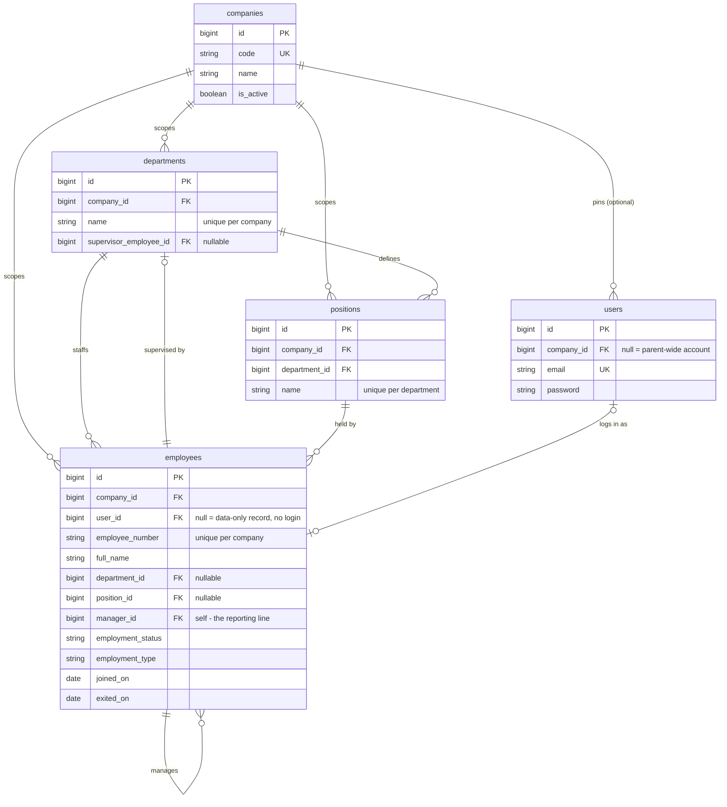
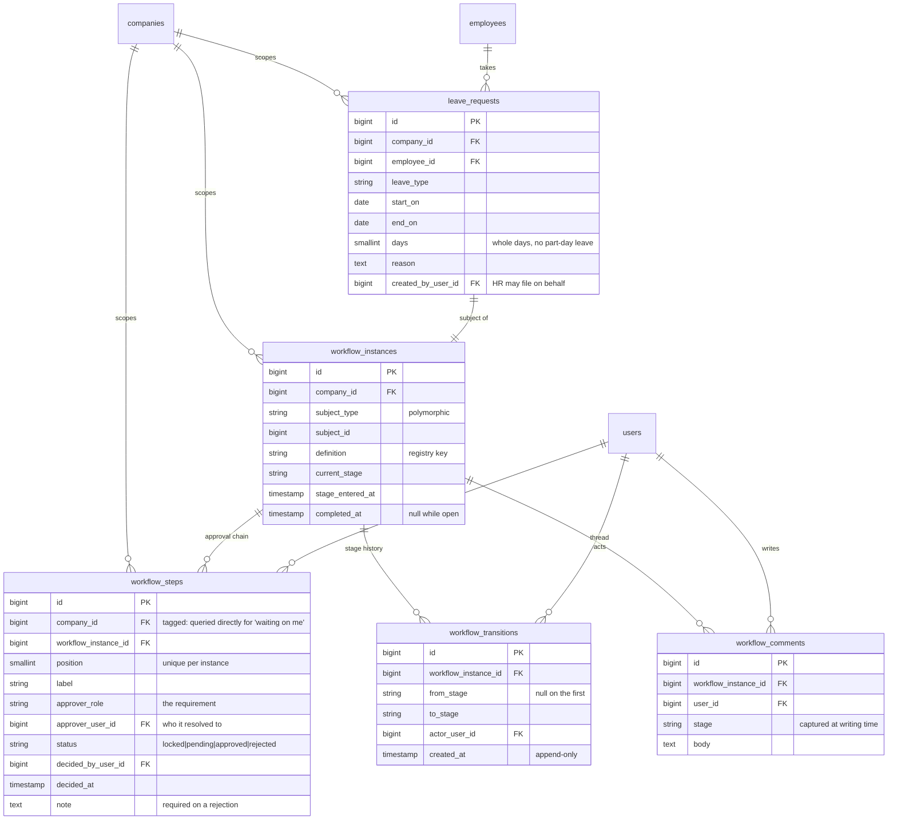

# HR Dashboard

Internal HR application for a parent group of three operating companies: one dashboard for HR
and management, and (later) a PWA for staff. Replaces a fragmented Access + Excel + PDF setup
with a single source of truth.

**Private by design.** The app is never exposed to the public internet — admins reach it over
Tailscale, employees over WireGuard. The only public surface in the whole system is the careers
intake on the existing CMP website, which the app talks to outbound only.

The full spec lives outside this repo in `../docs/`:

| Document                                                | What it is                                                         |
| ------------------------------------------------------- | ------------------------------------------------------------------ |
| `../docs/context.md`                                    | The living spec: scope, architecture, decisions, process flows     |
| `../docs/HR_Dashboard_Features_and_Test_Scenarios.xlsx` | **Master** screen / feature / test list — 57 screens, 309 features |
| `../docs/dev-concepts.md`                               | Learning log: one entry per Laravel concept this app uses, and why |
| `../ATTENDANCE-SYNC.md`                                 | The Fingerspot scanner pipeline design and probe runbook           |

Where this README and the workbook disagree on feature detail, **the workbook wins**. This file
tracks structure and progress; the workbook tracks requirements and tests.

---

## Status

Phases 0 and 1 are largely done and Phase 2 (attendance) is mostly built; what remains in them is
listed in the checklist below. Nothing here is committed yet: changes are left for review.

|                 |                                                                                                              |
| --------------- | ------------------------------------------------------------------------------------------------------------ |
| Tests           | 418 passing                                                                                                  |
| Static analysis | PHPStan level 7, 0 errors                                                                                    |
| Phase 0         | **Complete** — company scoping, RBAC, workflow engine, account state and login rules                         |
| Phase 1         | Directory (with CSV import/export), profile, add/edit, documents, admin panel done                           |
| Phase 2         | Scan-log import, ingest API + agents, calendar, holidays/events, recap/export, issues, timesheet corrections |
| Also built      | Leave requests end to end — the first real workflow consumer                                                 |
| Not built       | Recruitment and offboarding screens; notifications, global search, employee app, on-site sync agent          |

---

## Stack

| Layer                       | Choice                                                                                                                                                        |
| --------------------------- | ------------------------------------------------------------------------------------------------------------------------------------------------------------- |
| Framework                   | Laravel 13 (PHP 8.4), single monolith                                                                                                                         |
| Designed screens            | Inertia v3 + React 19 + TypeScript, Tailwind 4                                                                                                                |
| Admin / back-office screens | Filament 5 — panel at `/admin`: companies, users, role permissions                                                                                            |
| Database                    | PostgreSQL 16 (Docker, port 5434 locally)                                                                                                                     |
| Auth                        | Laravel Fortify — session login, 2FA, password reset, email verification. Registration is **not** enabled, which matches the spec: accounts are created by HR |
| Roles                       | spatie/laravel-permission (`teams` feature deliberately **off**)                                                                                              |
| Audit                       | spatie/laravel-activitylog                                                                                                                                    |
| Routes → TypeScript         | Laravel Wayfinder                                                                                                                                             |
| Tests                       | Pest (SQLite in-memory)                                                                                                                                       |
| Background work             | Database queue driver — no Redis                                                                                                                              |
| Local environment           | Docker Compose: `app` + `queue` + `vite` + `db`. Host PHP/Node optional                                                                                       |

---

## Running it

Docker is the supported way to run this — nothing needs to be installed on the host except
Docker Desktop. No PHP, Composer or Node. Commands for the backend run in the `app` service
(working directory `backend/`); commands for the frontend run in the `vite` service (working
directory `frontend/`).

```bash
docker compose up -d              # db + app + queue + vite

docker compose exec app php artisan migrate
docker compose exec app php artisan db:seed --class=DevAccountSeeder
```

Then open **http://localhost:8001**.

| Service | Port     | What it is                                                                                            |
| ------- | -------- | ----------------------------------------------------------------------------------------------------- |
| `app`   | **8001** | the application — this is the one you open                                                            |
| `vite`  | 5173     | the asset dev server. Opening it directly shows Vite's own landing page; that is normal, not an error |
| `db`    | 5434     | PostgreSQL, published so host tools can still connect                                                 |
| `queue` | —        | `queue:work` — restart it after changing job code                                                     |

> The first `docker compose up` is slow: it runs `composer install` and `npm ci` into named
> volumes. Later starts are quick.

> This replaced the standalone `../ops/local-postgres/` compose, retired 2026-10-06. If its old
> data volume is still on your machine: `docker volume rm local-postgres_hr-pgdata`.

Seeded logins, all with password `password`:

| Email                  | Role         | Company                         |
| ---------------------- | ------------ | ------------------------------- |
| `group@hr.test`        | HR Admin     | parent-wide — switcher unlocked |
| `hr.a@hr.test`         | HR Admin     | Company A — switcher locked     |
| `admin@hr.test`        | System Admin | parent-wide                     |
| `supervisor.a@hr.test` | Supervisor   | Company A — read-only           |
| `employee.a@hr.test`   | Employee     | Company A — own profile only    |

`employee.a@hr.test` is the ordinary person's view: no directory, no admin panel, only their own
profile (with their own salary and bank details), their own leave requests, and the one ordinary
document filed on them. A restricted document is filed on the same record to show that it stays
hidden from them.

### Checks

```bash
docker compose exec app php artisan test --compact        # all tests
docker compose exec app php artisan test --filter=Workflow
docker compose exec app vendor/bin/pint                   # format PHP
docker compose exec app vendor/bin/phpstan analyse        # level 7
docker compose exec vite npm run check                    # lint + format the front end
docker compose exec vite npm run types:check              # tsc --noEmit
docker compose exec vite php ../backend/artisan wayfinder:generate --with-form --path=./src
```

> The Vite dev server already does this on every start and whenever a route or controller
> changes, so you rarely run it by hand. When you do: `--with-form` is not optional
> (`vite.config.ts` sets `formVariants: true` and the Artisan command does not read it, so
> omitting the flag silently drops the `.form` helpers and breaks the type-check in files you
> never touched), and `--path=./src` is what puts the output in the frontend — without it,
> Wayfinder writes into `backend/resources/js`, which is not used.

### Why pages are as fast as they are (and what is still slow)

A page load on the Windows bind mount was taking about **3.4 seconds**, almost all of it booting
the framework rather than running the page. It is now about **0.8–1.1 seconds**. What was done,
so it is not undone by accident:

- **The admin panel's resources are registered only where the panel is served**
  (`AdminPanelProvider::resources()`), not on every request. Filament registers panels when the
  app boots, so every page — including ones with nothing to do with the panel — was paying about
  0.7s for six resources. They are listed explicitly rather than discovered (discovery scans
  folders on every request). **A new Filament resource must be added to that list.**
- **The sidebar's admin-panel check is `User::canAccessAdminPanel()`**, which does not need
  Filament loaded.
- **The queue worker is `queue:work`, not `queue:listen`.** `listen` re-boots the whole
  framework on every poll and held a core at 50% doing nothing.
- **Vite polls every 1000ms, not 300ms**, which had kept another core busy.

Still slow, and not fixed here: the code lives on a Windows bind mount, so every config, route
and class file is read across it. Two things would help further and were deliberately not done:
caching config (`php artisan config:cache`) is unsafe with this test setup, because a cached
config ignores `phpunit.xml` and the suite would run against the development database; and
moving the repository into the WSL2 filesystem would remove the bind-mount cost altogether.

### Why the compose file looks the way it does

Seven decisions that are load-bearing — changing them reintroduces bugs that were genuinely
painful to diagnose:

- **`vendor/` and `node_modules/` live in named volumes, not the bind mount.** `vendor/` is
  ~10k files; serving it from the Windows host made a bare framework boot take **6–15 seconds**
  and page renders time out entirely. In a named volume the same request takes **~0.2s**. Your
  source files stay bind-mounted and live-editable, and the host keeps its own `vendor/` on
  disk for IDE intellisense — the volume only shadows it inside the container.
- **Compose sets only `DB_HOST` and `DB_PORT`, never `DB_CONNECTION` or `DB_DATABASE`.**
  Compose variables also land in `$_SERVER`; Laravel's `env()` reads `$_SERVER` before `$_ENV`;
  and `phpunit.xml`'s `force="true"` cannot reach `$_SERVER`. Setting them here makes
  `php artisan test` run against the **development database**, and `RefreshDatabase` wipes it.
  It did, twice, before this was understood.
- **Node ships inside the PHP image.** The Wayfinder Vite plugin shells out to
  `php artisan wayfinder:generate` whenever the dev server starts, so a Node-only container
  cannot run Vite at all. One image, two services.
- **`artisan serve` runs with `--no-reload`.** Without it `PHP_CLI_SERVER_WORKERS` is ignored
  and the dev server handles one request at a time. It only disables restart-on-`.env`-change,
  not picking up code edits.
- **The two projects must stay siblings.** The Vite config reaches the backend as `../backend`
  (for `artisan`, `public/`, and the route files it watches), and the containers mount them at
  `/var/www/backend` and `/var/www/frontend` to match. Moving either breaks the build.
- **The container entrypoint prepares the backend in a subshell.** Every service shares it, but
  the `vite` service runs from `frontend/`; if the script `cd`'d into the backend and stayed
  there, Vite would start in the wrong directory.
- **`@/` is defined in `vite.config.ts`, not just `tsconfig.json`.** See the note under *Where
  things live*; without it every `@/` import fails to resolve and the page is blank.

Also: `vite.config.ts` sets `server.origin` from `VITE_DEV_SERVER_URL`, because
laravel-vite-plugin writes that value verbatim into `backend/public/hot` and the browser —
outside the container — must be able to reach it. And `build.emptyOutDir` is on, because the
build output (`backend/public/build`) sits outside the frontend's root and Vite will not clean
a folder it does not own unless told it may.

**Inertia SSR is off in the container** (`INERTIA_SSR_ENABLED=false`). In dev it makes every
page render a second round trip into the Vite container for no local benefit. To exercise it,
flip that to `"true"`; `INERTIA_SSR_HOT_URL` is already set so the cross-container call works.
Production keeps SSR on.

### Running on the host instead

Still supported if you have PHP and Node (Herd). `.env` points at `127.0.0.1:5434`, which the
`db` service publishes, so you can run the database in Docker and the rest on the host:

```bash
docker compose up -d db
cd backend && php artisan migrate && php artisan db:seed --class=DevAccountSeeder
composer run dev   # serve + queue + `npm --prefix ../frontend run dev`
```

## Where things live

The repository holds **two projects side by side**. They are still joined at runtime — the
backend renders pages with Inertia and serves the frontend's build — but they are separate
folders with their own dependencies, configs and tooling.

```
hr-application/
├── backend/              the Laravel app — PHP, Composer, PostgreSQL
├── frontend/             the React app — Node, Vite, TypeScript, Tailwind
├── docker/               PHP config + the container entrypoint
├── Dockerfile            one image (PHP + Node) used by every service
├── docker-compose.yml    db · app · queue · vite
└── README.md
```

The two meet in exactly four places. Anything else crossing the boundary is a bug.

| Seam | Where | What it does |
|---|---|---|
| Pages | `frontend/src/pages` ← `backend/config/inertia.php` | Inertia resolves a component name to a file here, and the test helper checks it exists |
| Built assets | `frontend/` → `backend/public/build` | `vite build` writes the bundle where Laravel serves it from |
| Dev hot file | `frontend/` → `backend/public/hot` | tells Laravel where the Vite dev server is |
| Typed routes | `backend/routes` + `app/**/Http` → `frontend/src/{actions,routes,wayfinder}` | Wayfinder generates TypeScript from the Laravel routes. **Generated; never edit, never commit** |

### Backend

Only the parts worth knowing. Framework scaffolding is omitted.

```
backend/
├── app/
│   ├── Concerns/
│   │   └── BelongsToCompany.php      every company-tagged model uses this, and only this
│   ├── Enums/
│   │   ├── EmploymentStatus.php      active | inactive
│   │   ├── EmploymentType.php        permanent | contract | probation | intern
│   │   ├── LeaveRequestStage.php     a WorkflowStage implementation
│   │   ├── LeaveType.php             the six leave types
│   │   ├── OffboardingCaseStage.php  a WorkflowStage implementation
│   │   ├── Permission.php            the permission vocabulary
│   │   ├── Role.php                  the 5 roles + the role → permission mapping
│   │   └── WorkflowStepStatus.php    locked | pending | approved | rejected
│   ├── Http/
│   │   ├── Controllers/              Employee, LeaveRequest, LeaveRequestDecision, CompanySwitcher
│   │   ├── Middleware/SetActiveCompany.php   resolves the active company, before Inertia shares it
│   │   └── Requests/                 validation + authorisation, one class per form
│   ├── Models/                       Company, Department, Position, Employee, User,
│   │   │                             LeaveRequest, Workflow{Instance,Step,Transition,Comment}
│   │   └── Scopes/CompanyScope.php   the tenancy filter
│   ├── Policies/                     one per model
│   ├── Support/                      CompanyContext (the active company), ReportingLine (downline)
│   ├── Actions/Leave/                SubmitLeaveRequest — builds the approval chain
│   ├── Listeners/LogRoleChange.php   audits role grants and revokes
│   └── Workflows/                    the approval engine (see "The three foundations")
├── config/                           inertia.php points page lookup at ../frontend
├── database/                         migrations · factories · seeders (DevAccountSeeder is local-only)
├── resources/views/app.blade.php     the thin Blade shell Inertia mounts into
├── routes/                           web.php · settings.php
├── tests/                            Pest — Feature, Unit, and a Fixtures/ subject for the engine
├── composer.json  phpunit.xml  phpstan.neon  pint.json
└── .env                              git-ignored; copied from .env.example on first run
```

### Frontend

```
frontend/
├── src/
│   ├── app.tsx                 Inertia entry point and layout resolution
│   ├── css/app.css             Tailwind entry, theme variables
│   ├── pages/                  one component per screen, mirroring the Laravel route names
│   ├── layouts/                app (sidebar/header), auth, settings
│   ├── components/             company-switcher, employee-form, leave-decision-dialog, …
│   │   └── ui/                 shadcn primitives — do not edit
│   ├── hooks/  lib/  types/    types/ holds the hand-written view models (employee, leave, company)
│   └── actions/ routes/ wayfinder/    GENERATED by Wayfinder
├── package.json  vite.config.ts  tsconfig.json  components.json
└── .gitignore                  ignores node_modules and the generated folders above
```

`@/` means `frontend/src/`. It is defined in `vite.config.ts` — `laravel-vite-plugin` ships a
default of `/resources/js`, which no longer exists, and `tsconfig.json`'s `paths` is only read by
the editor and `tsc`, not by Vite.

---

## Data model

Derived from the migrations and the model relationships as they stand.

### Core: companies, org chart, accounts



Three things in that diagram carry most of the design:

- **`company_id` is everywhere.** It is the tenancy key; `CompanyScope` filters every query by
  it. See _Company scoping_ below.
- **`users.company_id` is nullable, and null means parent-wide** — an account that may switch
  companies or view them combined. Every other account is locked to one.
- **`employees.user_id` is nullable.** Warehouse staff exist as dossier records with no login,
  so they are never actors or approvers.

`employees` also carries the four dossier card groups from the design (`EMP-DET`): contact +
emergency contact, bank and tax, payroll, and health and insurance — 23 nullable columns left
off the diagram to keep it readable. **Money is integer rupiah** (`base_salary_idr` and
friends), never a float.

### The approval workflow engine



`subject_type` / `subject_id` is polymorphic and unique together: any model can be a workflow
subject, and runs through one workflow at a time. No module uses it yet.

### Framework- and package-owned tables

Not ours to design, listed so the diagrams above read as complete:

`users` extras from Fortify (`two_factor_*`), `password_reset_tokens`, `sessions`, and
`passkeys` — which exists from a shipped migration but is **unused**, since the passkey feature
is not enabled ·
`roles`, `permissions`, `model_has_roles`, `model_has_permissions`, `role_has_permissions`
(spatie/permission) · `activity_log` (spatie/activitylog) · `cache`, `cache_locks`, `jobs`,
`job_batches`, `failed_jobs`, `migrations`.

---

## The three foundations

These are the XXL items the spec says to get right first, because retrofitting any of them
means reopening every module. Full reasoning in `../docs/context.md` §13.

### 1. Company scoping

One database, three companies, strict separation. Four pieces:

| File                                       | Job                                                                                                                            |
| ------------------------------------------ | ------------------------------------------------------------------------------------------------------------------------------ |
| `backend/app/Concerns/BelongsToCompany.php`        | Apply this trait and nothing else. Registers the scope, fills `company_id` on create, provides the `acrossCompanies()` bypass. |
| `backend/app/Models/Scopes/CompanyScope.php`       | Filters every query on a tagged model.                                                                                         |
| `backend/app/Support/CompanyContext.php`           | Holds the active company for the request.                                                                                      |
| `backend/app/Http/Middleware/SetActiveCompany.php` | Resolves it **from the user's record, never from request input**.                                                              |

`CompanyContext` has **three states, and the difference matters**:

- **constrained** — one company selected, filter on;
- **combined** — a parent-wide role deliberately viewing all three, no filter;
- **unresolved** — console, queue, tests: no filter, because there is no user to scope to.

Only the first filters. Code that runs unresolved **must scope its own queries** — a console
command cannot assume the scope protects it. The deliberate bypass is `acrossCompanies()`;
authorise the caller before using it.

### 2. RBAC

Roles and permissions are **enums**, not strings, and the role → permission mapping lives on
`Role::permissions()`. That mapping is only the **starting point**: `RoleSeeder` creates a role
with its defaults and then never touches it again, so what a role may do is managed from the
admin panel (`/admin/roles`) and survives re-seeding. The cost is that a permission added to
the enum later reaches new installs only — grant it to existing roles from the panel.

| Role                    | Holds                                                 |
| ----------------------- | ----------------------------------------------------- |
| System Admin            | accounts, roles, companies, org — **not** the dossier |
| HR Admin                | the dossier, documents, sensitive data and attendance data + org — **not** accounts or roles |
| Management / Supervisor | view employees only (no documents, bank, payroll or health) |
| Employee                | nothing; sees their own record via policy             |

Policies re-check the company even though `CompanyScope` already filters, because a model
fetched via `acrossCompanies()` or resolved in a console context has not been filtered.
`UserPolicy` has **no such safety net** — `User` is not company-tagged, since a parent-wide
account has no company — so its company comparison is the only separation there is.

spatie's `teams` feature is **off**. Tenancy here is `CompanyScope`; enabling teams would give
two competing mechanisms for one job.

### 3. The approval workflow engine

Shared by Requests, Recruitment and Offboarding so they cannot drift into three different
notions of "approved". A module supplies a stage enum and a `WorkflowDefinition`; the engine
supplies the four tables and `WorkflowEngine`, which is the only way any of it changes. Every
write is one transaction.

Decisions you will trip over otherwise:

- **An unconfigured chain blocks a gated stage.** "No approvals required" and "approvals not
  set up yet" look identical to a naive guard, and only one is safe to let through.
- **A resolved approver is binding.** Once a step names a person, only that person decides it —
  holding the same role is not enough.
- **A rejection stops the chain** rather than opening the next step, and requires a reason.
- **Two kinds of refusal.** `InvalidTransition` = the definition forbids the move, i.e. a bug
  the UI should not have offered. `TransitionBlocked` = legal but a guard refuses now, i.e.
  ordinary, so it carries messages. `blockingReasons()` is public and separate so a screen can
  disable an action _and say why_.

Originally planned on spatie/laravel-model-states; dropped 2026-10-05 — reasoning in
`../docs/context.md` §5.3 and §13.2.

---

## Conventions

- **Never register `CompanyScope` by hand** and never hand-write `where('company_id', …)` on a
  tagged model. The trait is the whole contract.
- **Use the enums.** `Role`, `Permission`, `EmploymentStatus`, `WorkflowStepStatus`. `User::isA(Role)`
  exists so a typo is a type error rather than a check that quietly returns false.
- **Pages never wrap themselves in `<AppLayout>`.** `app.tsx` already applies it to every
  non-auth page, so wrapping again renders the sidebar and header twice. A page returns plain
  content and declares `Page.layout = { breadcrumbs }`; breadcrumbs that depend on props use
  `setLayoutProps({ breadcrumbs })` instead (see `frontend/src/pages/employees/show.tsx`).
- **Money, when it arrives, is integer rupiah.** No floats.
- **UI text is Indonesian**, held in translation files so English can be added later.
- **PHPStan runs at level 7**, which means every Eloquent relation needs its generics:
  `@return BelongsTo<Company, $this>`. It is not optional and it has caught real bugs.
- **Model attributes use PHP attributes**, matching the starter kit: `#[Fillable([...])]`,
  `#[Hidden([...])]`, and a `casts()` method.
- **Dates are `CarbonImmutable`** (set in `AppServiceProvider`).
- **Tests run on SQLite in memory**, not Postgres. Anything relying on Postgres-specific
  behaviour needs checking against the real database too.

---

## Development checklist

57 screens from the workbook, grouped into phases. **The workbook is the master** — it holds
the 309 features, their sizes and priorities, and the test cases. This table is the map.

`f` = feature count · `P1` = must-have count · status: ✅ done · 🟡 partial · ⬜ not started

### Phase 0 — Foundations ✅

| Screen     | Name                          | f   | P1  | Status | Notes                                                                                                                                                                                                                                                         |
| ---------- | ----------------------------- | --- | --- | ------ | ------------------------------------------------------------------------------------------------------------------------------------------------------------------------------------------------------------------------------------------------------------- |
| `CORE-NAV` | Company switcher              | 4   | 3   | ✅     | Scoping + switcher + server-side lock                                                                                                                                                                                                                         |
| `CORE-RBA` | Role & permission enforcement | 7   | 6   | ✅     | Roles, permissions, policies, reporting-line downline resolver (004), role-change audit (007)                                                                                                                                                                 |
| `CORE-WFL` | Approval workflow engine      | 9   | 7   | ✅     | All nine, including acting on an approval over HTTP (009). The "or app" half waits on the PWA                                                                                                                                                                 |
| `CORE-AUT` | Login & session               | 8   | 8   | 🟡     | Session login + 2FA (001), employee-ID login (002), temporary passwords forced to change (003), admin reset (004), idle expiry = `SESSION_LIFETIME`, 120 min (005), session/token revocation (006), failed-login throttling (007). Missing: scoped employee-app tokens (008) — waits on the employee app |

### Phase 1 — Employee dossier & admin screens

| Screen     | Name                                   | f   | P1  | Status | Notes                                                                                                                                                 |
| ---------- | -------------------------------------- | --- | --- | ------ | ----------------------------------------------------------------------------------------------------------------------------------------------------- |
| `EMP-DIR`  | Employee directory (list)              | 12  | 12  | ✅     | Search, department/position multi-select, status chips, sort, active-filter strip, row summary, CSV import (010) and CSV export of the filtered list (011) |
| `EMP-GRD`  | Directory — grid view                  | 1   | 1   | ✅     | A view over the same filtered query; each card shows the profile picture, or initials |
| `EMP-CHT`  | Directory — org chart                  | 1   | 1   | ✅     | A top-down tree drawn from `manager_id` with connector lines; anyone whose manager is filtered out renders as a root |
| `EMP-ADD`  | Add / edit employee                    | 6   | 6   | ✅     | One form for both. Self-referencing manager refused; company filled from the active company                                                           |
| `EMP-PRF`  | Profile shell                          | 3   | 2   | 🟡     | Header stats + tabs (Overview, Absensi, Pengajuan, Dokumen, Tim). Opens as a side drawer from the directory. Change audit is on (003); "SOPs to acknowledge" stays dropped with the Knowledge Hub |
| `EMP-DET`  | Profile — overview tab                 | 6   | 5   | ✅     | All five card groups render; bank, payroll and health are withheld from roles without `view-sensitive-data` (006) |
| `EMP-DOC`  | Profile — documents tab                | 4   | 2   | ✅     | Upload, categorise, version, expiry flags and per-document restriction. Reminders are in-app only — see Known gaps |
| `EMP-ATT`  | Profile — attendance tab               | 3   | 3   | 🟡     | Timesheet, manual add/change/void with reason + audit, recompute done. Totals by department/period are not |
| `EMP-REQ`  | Profile — requests tab                 | 2   | 2   | ✅     | Real: lists the employee's leave requests and leave taken this year                                                                                   |
| `CORE-USR` | User & role management                 | 6   | 5   | ✅     | Policies and Filament screens (users, roles, permissions); activate/deactivate, last login, temporary password, reset password and revoke sessions per user |
| `CORE-ORG` | Departments, positions, reporting line | 4   | 4   | ✅     | Schema, policies, the downline resolver and Filament screens for departments and positions                                                                         |
| `CORE-ADM` | Company settings                       | 1   | 0   | 🟡     | Filament company screen done                                                                                                                                |

### Phase 2 — Attendance

Sync first: it is the prerequisite for any real attendance data, and the on-site probe has
**not been run yet** (`../ATTENDANCE-SYNC.md`). Until it is, the log is captured by hand: someone
runs Personnel's **Download ScanLog** at the end of each working day and loads the file at
`/attendance/device` ("Data absensi" in the sidebar). The scanner IDs are matched to employees
there too.

How the import behaves, so it is not surprised by:

- **Idempotent.** Punches are de-duplicated on (device serial, scan time, PIN), the same key as
  Personnel's `att_log`. The same file twice, or two overlapping files, adds nothing the second
  time; the page reports "baru / duplikat / menunggu / ditolak" for every load.
- **Unmapped PINs are held, never dropped**, in `attendance_unmapped_punches`. Mapping the PIN
  moves its waiting punches into attendance in the same step. A PIN that equals exactly one
  employee number is offered as a suggestion.
- **Mappings can carry dates**, because scanners reuse PINs. The mapping in force on the day of
  the scan wins, judged in the scanner's timezone.
- **Times are interpreted in `ATTENDANCE_DEVICE_TIMEZONE`** (default `Asia/Jakarta`), because the
  scanner records local time with no zone. They are stored in UTC and shown back in the scanner's
  zone. Wrong zone, and every punch shifts by the difference.
- **"Data sampai" matters.** While capture is manual the data is only as fresh as the last
  upload, so nothing built on it may read the days after it as absence. The status shows
  Terkini / Terlambat against the previous working day; public holidays are not known yet, so a
  holiday can show as late. The dashboard shows a card to the people who load the log, but only
  when something needs doing.
- **Open to parent-wide accounts holding `manage-attendance` only** (HR Admin by default). The
  scanner serves the whole group, so a company-pinned HR admin cannot load or map.
- **The file format is not verified.** Personnel's real export has not been inspected, so the
  parser reads a CSV header and recognises common column names (English and Indonesian) rather
  than one fixed layout. Needed: a PIN column and a date-time column (or separate date and time
  columns); optional: device serial, verify mode, in/out mode. Dates are read day-first. If a
  real export differs, adapt the alias lists in `App\Support\Attendance\ScanLogParser`.
  `backend/tests/Fixtures/scanlog-sample.csv` is a sample to try the page with (PINs 1001–1005
  and an unknown 9999).
- **The calendar (`/attendance/calendar`, "Kalender absensi")** derives each person's day from the
  raw punches every time; nothing is stored, so a late upload or a corrected mapping changes it
  immediately. It needs the `view-attendance` permission (HR Admin by default) and follows the
  company switcher. The rules, in order, are in `DayClassifier`:
  1. a day after the last captured data is **no data**, never absence — except what is known in
     advance: a holiday is **off** and approved leave is **leave**, even in the future (leave
     shows on weekends too, matching the day count on the request);
  2. a holiday or event covering the person is **off**; a day nobody at all scanned on is also
     off, as a fallback for a holiday nobody entered;
  3. any punch makes the day present / late / early-leave, even on leave or a weekend;
  4. approved leave is leave, and otherwise a non-workday is off;
  5. someone with **no scanner ID mapped** on that date is no data, not absent — nothing could
     have been recorded for them. Rows say "ID pemindai belum dipetakan".
  Only then is a workday with no scan an absence.
- **The Day view is a list, not a grid:** one row per person with Jabatan, Atasan, Masuk (first scan),
  Pulang (last scan, blank for a single scan) and a Status column (Hadir / Terlambat / Cuti …; a
  holiday shows its name). The date is not repeated as a column; it is in the toolbar.
- **Week, month and year are summaries, not grids of people.** Each answers how many came in and how
  many were late or away, at a different scale; clicking a day opens its Day view, where the people
  are listed (and a month opens from the year view).
  - **Week:** a bar per day (checked in, with the late share marked), the weekday average as the
    headline, weekends and holidays hatched.
  - **Month:** a Monday-first calendar of day tiles with the head count, "n cuti · m terlambat", the
    holiday's name, today outlined, and a flag when under 60% of the people expected came in.
  - **Year:** the attendance rate per month (under 90% highlighted, months with no data hatched), the
    year's rate as the headline, and a table per month of working days, leave days, late arrivals and
    unexplained absences with a total row.
  - **The rate is attended ÷ (attended + absent).** Approved leave counts neither for nor against, and
    a day or month the log has not reached shows "—", never 0%. The side panel uses the same
    definition. Leave, late and absent in the year table are person-days. The filters (department,
    team, leave type, status) apply to all of these, and the CSV export of the year view carries the
    rate and working days.
- **Layouts are checked at phone width (390 px).** The header shows only the current page's name and a
  narrower company switcher; the profile's tabs wrap instead of running off screen; tables that scroll
  sideways keep their headings on one line, with the name column pinned on the recap; the calendar's
  Day view and the employee list drop their secondary columns (position and supervisor appear under the
  name); month tiles show the count (and "n cuti") and leave the rest to the Day view; and the issues
  screen becomes a list of cards. The dashboard's grey placeholder blocks are the starter kit's and
  are not real content.
- **An employee's Absensi tab has a Bulan / Tahun toggle.** Tahun is the whole year in one table: per
  month hadir, terlambat, pulang cepat, tidak hadir, cuti, working hours and the rate, with a total
  row and a bar per month; opening a month goes to its day-by-day timesheet. It is fetched the same
  way (`?period=year&year=YYYY` on the profile's partial reload).
- **Working hours are set in the admin panel** (`/admin`, "Jam kerja", parent-wide HR Admin
  only): start, end and the lateness tolerance in minutes. Nothing in the requirements defines
  them, so until someone saves their own, `config/attendance.php` supplies 08:00, 17:00 and 10
  minutes. They live in `app_settings` and apply at once; each change is on the audit trail.
  **Saturday and Sunday are fixed as non-working in code** and are deliberately not a setting.
  One schedule applies to everyone: shift work (a warehouse) would need one per employee or
  department. First scan is the check-in and last scan the check-out; the scanner's in/out flag is
  not trusted. A day with a single scan is never judged an early departure.
- **The profile's attendance tab** (`EMP-ATT`) is sent only when opened (an Inertia optional prop,
  fetched by a partial reload), so the profile does not pay for a month of scans on every visit.
  It shows each day's status, first/last scan and duration, plus the scans behind them. People
  with `correct-attendance` (HR Admin) can add a scan, change a time, or void a scan, each with a
  mandatory reason. **The punch log stays append-only**: a voided scan is kept, struck through
  with who voided it and why, and everything derived ignores it; a changed time is a void plus a
  new `manual` punch. All of it is on the audit trail. An employee sees their own timesheet but
  cannot correct it.
- **Issues** (`/attendance/issues`, "Masalah absensi") are never stored: they are read off the same
  derived days as the calendar, so correcting a scan or approving leave makes one disappear. Five
  kinds: late, early leave, no check-out (a single scan on a day that is over), absent without
  approved leave, and doubled scans (two within 2 minutes). Only the decision to **excuse** one is
  stored (`attendance_issue_resolutions`), with a mandatory reason and who made it, and it can be
  reopened. Excusing is bulk-capable and refused for the whole batch if any employee is outside
  the user's reach. Ranges are capped at 62 days.
- **Holidays and events** (`ATT-WIZ`, the "Hari libur & acara" card on the calendar) are stored in
  `calendar_events`, each for the whole group, one company, or one department, up to 31 days. They
  need `manage-calendar-events` (HR Admin by default); a company-pinned admin can only add for
  their own company and can only delete their own company's. Everything is on the audit trail.
- **Recap and export.** `/attendance/recap` ("Rekap absensi") totals each person's statuses over
  a range of up to 366 days, with the same department/team/leave-type filters, `?export=csv`, and
  a print layout (browser "save as PDF"; no PDF library). The calendar toolbar has "Unduh CSV" and
  "Cetak". CSV cells that start with `= + - @` are prefixed so a spreadsheet will not run them.
- **Ingest endpoint and agents.** `POST /api/attendance/punches` accepts batches from the on-site
  agent, through the same `IngestPunches` as the file import, so both are idempotent and behave
  identically. Auth is a **Sanctum token only** (no cookies) with the `attendance:ingest` ability,
  one token per `AttendanceAgent`, limited to 120 requests a minute per token. Agents are created
  in the admin panel ("Agen sinkronisasi"); the token is shown **once** and creating a new one
  rotates it. Every batch, including rejected ones, is in a read-only request log in the panel.
  The device page lists agents with last report and listener heartbeat, and **"Sinkronkan
  sekarang"** asks the agent to sync on its next call (the response carries `sync_now`). An agent
  silent for over 3 hours during working hours shows as "Diam" and raises a dashboard warning.
- **Accounts.** A user is deactivated, never deleted; deactivating signs them out everywhere and
  cancels their tokens. Sign in with an email or an employee ID; an ID shared by two companies is
  refused and that person uses their email. A failed login gives the same message whatever the
  reason. An account created or reset by an administrator carries a temporary password and can
  reach nothing but the security page until it is changed. The sessions are database-backed, which
  revoking relies on. Idle expiry is `SESSION_LIFETIME`.
- **Not built yet:** totals per department or period on the timesheet (`EMP-ATT-003`), the year
  view per employee, a notification to the employee and supervisor about an issue (needs the
  notifications module), the on-site agent and listener, xlsx import, and weekend/holiday-aware
  leave day counts.

| Screen    | Name                      | f   | P1  | Status | Notes                                                            |
| --------- | ------------------------- | --- | --- | ------ | ---------------------------------------------------------------- |
| `ATT-DEV` | Device integration health | 6   | 5   | 🟡     | Manual CSV import, enrol-ID mapping, capture status, the token-only ingest endpoint, agent registry/health and "sync now" done. The on-site agent and listener themselves (002, 006) are not built here |
| `ATT-CAL` | Attendance calendar       | 5   | 5   | 🟡     | Day / week / month / year, department/team/leave-type filters, status rules, holidays and approved leave shown ahead of the data, CSV export, printable recap. A separate live board is covered by the Day view |
| `ATT-SID` | Calendar side panel       | 3   | 1   | ✅     | Headcount, out today / upcoming and the approvals link, from the same rows as the grid |
| `ATT-WIZ` | Calendar event wizard     | 1   | 1   | ✅     | Holidays and company/department events, with audit. `WorkingDays` exists for leave day counts but is not wired in yet |
| `EMP-ATT` | Profile — attendance tab  | 3   | 3   | 🟡     | Timesheet, manual add/change/void with reason + audit, recompute done. Totals by department/period are not |

### Phase 3 — Requests (leave) + notifications

The first real consumer of the workflow engine. `ATT-ISS` lands here, not in Phase 2, because
unapproved-absence detection needs approved-leave data.

| Screen     | Name                   | f   | P1  | Status | Notes                                                      |
| ---------- | ---------------------- | --- | --- | ------ | ---------------------------------------------------------- |
| `REQ-WIZ`  | New leave request      | 9   | 9   | ⬜     | Working-day calc excluding weekends + calendar events (L)  |
| `REQ-DSH`  | Requests queue         | 7   | 4   | ⬜     | "Waiting on" comes from the engine                         |
| `REQ-DLG`  | Decision dialog        | 5   | 5   | ⬜     | Approve/reject — engine already does this                  |
| `ATT-LVE`  | Absensi › Cuti         | 10  | 5   | ⬜     | Day picture, 14-day availability, headcount reconciliation |
| `EMP-REQ`  | Profile — requests tab | 2   | 2   | ⬜     |                                                            |
| `ATT-ISS`  | Attendance issues      | 6   | 4   | 🟡     | Five exception types, filters, bulk excuse with audit, reopen. Notify employee + supervisor waits on notifications |
| `CORE-NOT` | Notifications          | 8   | 5   | ⬜     | In-app + email first; Web Push with the PWA                |

**Open rules to settle before building:** does a rejection require a reason (offboarding's
does)? Which leave types require evidence? Is there an annual entitlement at all, or only
leave-taken? _(The last one was settled: leave-taken only — no balance.)_

### Phase 4 — Recruitment

The largest and most integration-heavy area. The internal slice can land before the Career page
and the scheduling automation.

| Screen                            | Name                        | f   | P1  | Status | Notes                                                       |
| --------------------------------- | --------------------------- | --- | --- | ------ | ----------------------------------------------------------- |
| `REC-DSH`                         | Recruitment dashboard       | 9   | 6   | ⬜     |                                                             |
| `REC-WIZ`                         | Requisition wizard shell    | 6   | 4   | ⬜     | Shell holds stepper/nav/draft                               |
| `REC-WZ1` · `REC-WZ2` · `REC-WZ3` | Wizard steps 01–03          | 8   | 7   | ⬜     | Kebutuhan · Detail & Persyaratan · Review                   |
| `REC-PIP`                         | Requisition pipeline        | 6   | 4   | ⬜     | 6-stage tracker — a `WorkflowDefinition`                    |
| `REC-APR`                         | Stage 01 Approval           | 9   | 5   | ⬜     | Engine's approval chain                                     |
| `REC-PST`                         | Stage 02 Posting            | 7   | 4   | ⬜     | Push listings to cmp-api                                    |
| `REC-SCR`                         | Stage 03 Screening          | 8   | 4   | ⬜     | Includes applicant ranking (XL)                             |
| `REC-INT`                         | Stage 04 Interview          | 8   | 3   | ⬜     | Google Meet + email, candidate reschedule (XL)              |
| `REC-OFS`                         | Stage 05 Offer              | 9   | 8   | ⬜     | Management final approval + offer letter                    |
| `REC-FIL`                         | Stage 06 Filled             | 7   | 6   | ⬜     | Convert-to-employee (L)                                     |
| `REC-CAN` · `REC-CDT` · `REC-CRV` | Candidate detail + tabs     | 11  | 8   | ⬜     |                                                             |
| `REC-OFR`                         | Send offer form             | 6   | 4   | ⬜     |                                                             |
| `REC-TPL`                         | Templates (admin)           | 1   | 0   | ⬜     |                                                             |
| `REC-EDI`                         | Post-interview form builder | 1   | 0   | ⬜     | P5 — backlog                                                |
| `REC-CAR`                         | Career page (public)        | 3   | 0   | ⬜     | **Built by the CMP team** on cmp.id; we supply the contract |

### Phase 5 — Offboarding

The workflow definition already exists (`OffboardingCaseWorkflow`) — this phase is the case
table, the checklist and the screens.

| Screen                            | Name                     | f   | P1  | Status | Notes                                                  |
| --------------------------------- | ------------------------ | --- | --- | ------ | ------------------------------------------------------ |
| `OFF-DSH`                         | Offboarding dashboard    | 10  | 5   | ⬜     |                                                        |
| `OFF-WIZ` · `OFF-WZ1` · `OFF-WZ2` | Case wizard + steps      | 11  | 8   | ⬜     | Notice-period check, compensation, case files          |
| `OFF-PIP`                         | Case pipeline            | 7   | 6   | 🟡     | Definition done (`OFF-PIP-003`); screens not           |
| `OFF-APR`                         | Stage 1 Diajukan         | 7   | 5   | ⬜     | Engine handles the chain + comments                    |
| `OFF-CHK`                         | Stage 2 Checklist        | 11  | 10  | ⬜     | Owner-only ticking; needs the blocked-completion guard |
| `OFF-SIG`                         | Stage 3 Sign-off         | 9   | 5   | ⬜     | Sequential sign-off, berita acara PDF                  |
| `OFF-ITM`                         | Checklist builder        | 5   | 2   | ⬜     |                                                        |
| `OFF-TPL`                         | Master item list (admin) | 4   | 2   | ⬜     |                                                        |

### Phase 6 — Home, search, employee app

| Screen     | Name                     | f   | P1  | Status | Notes                                                                                                     |
| ---------- | ------------------------ | --- | --- | ------ | --------------------------------------------------------------------------------------------------------- |
| `DAS-MAI`  | Home                     | 5   | 3   | ⬜     | Cross-module KPIs — needs the modules to exist first                                                      |
| `CORE-SRC` | Global search & settings | 4   | 2   | ⬜     | Includes the Indonesian translation-file setup (004)                                                      |
| —          | Employee app (PWA)       | —   | —   | ⬜     | Manifest, service worker, install prompt, Web Push, Sanctum API. Workbook has no screen rows for this yet |

### Phase 7 — Deployment & VPN

Not screens. Nginx bound to the private addresses only, PHP-FPM, queue worker and scheduler
units, DNS-01 certificate for `hr.cmp.id`, WireGuard + wg-easy, Tailscale, separate Linux user
and DB credentials, and a check that the public IP never serves this app.

Nothing in the app blocks this — a working login and `/up` is all the VPN test needs.

### Deferred, not in this build

Knowledge Hub (`../docs/context.md` Appendix B) · Company Car Tracker (Appendix A) · Process
Progress Tracking analytics (Appendix C).

---

## Known gaps worth remembering

- **Documents are private, and two permissions gate them.** Files live on the `local` disk
  (`storage/app/private`), never under `/storage`, and are served only by an authorised route.
  `view-documents` and `manage-documents` decide what a role may do with ordinary documents; a
  document marked _restricted_ additionally needs `view-sensitive-data`, the same permission
  that gates the bank, payroll and health cards on the profile. An employee sees their own
  ordinary documents and their own bank/payroll, never restricted ones. A restricted document a
  viewer cannot see is omitted entirely. Downloads of restricted documents are written to the
  audit trail. Access is by role, not per person — there is no allow-list of named users.
- **Expiry reminders are in-app only.** Lapsing documents (past their date or within 30 days)
  show on the dashboard for roles that can view documents. Nothing is emailed or pushed; that
  waits for the notifications module (Phase 3).
- **Documents are soft-deleted**: the record disappears but the files stay on disk.

- **No test cases in the workbook** for `CORE-*` or `EMP-*` — the Pest suite covers them, but
  the workbook's coverage figures do not reflect that. Only Recruitment has test-case rows.
- **The admin panel covers companies, users, role permissions, departments, positions and a
  read-only audit log.** The panel needs the `access-admin-panel` permission **and** a
  parent-wide account. It has no login page of its own: a guest is sent to the app's `/login`
  (two-factor included). Signing in **never** lands anyone in the panel on its own — a
  remembered `/admin` address is dropped and they go to the dashboard, so someone without access
  is not thrown a 403 straight after login. The panel is opened from the sidebar's "Panel admin"
  link, and has a "Kembali ke dashboard" entry and logo link back. Signing out from the panel
  ends the whole session.
  `SetActiveCompany` runs inside it and is registered as _persistent_ middleware: without that,
  Filament's search, sort and pagination (Livewire requests) would drop the company scope.
  The audit log is gated by `manage-users`, not a permission of its own.
- **Profile pictures sit on the public disk** (`storage/app/public/employee-photos`, served at
  `/storage`) under random file names. They are reachable by anyone who has the URL, unlike the
  rest of the dossier. If that is not acceptable, they need a private disk and an authorised
  route. The container image has no GD extension, so there is no server-side resizing.
- **The profile opens as a side drawer from the directory.** Clicking a row, card or org-chart node
  slides the profile in over the list instead of navigating (Ctrl/Cmd/Shift-click still opens the
  full page). The drawer reads `GET /employees/{id}/summary` (JSON, same authorisation as the
  profile) and has Profil, Dokumen, Cuti, Absensi and Tim tabs. **It is read-only on purpose:**
  uploading a document or correcting a scan redirects, which would navigate the list away from
  under it, so those stay on the full page ("Buka profil penuh"). "Ubah data" and "Ajukan cuti"
  are links; "Ajukan cuti" opens the leave form and does not preselect the employee.
- **A leave request on the profile opens to its detail** (Pengajuan tab and the drawer's Cuti tab): the
  requester's note, and the approval chain with each reviewer, the date, and the note they left. The
  requester reads a rejection's reason here as well as in the queue's dialog; both read the same step
  notes. Anyone who can see the profile's requests sees these notes.
- **The "Tim" tab** (drawer and full profile) shows a slice of the reporting line, not the whole
  chart: the supervisor and their supervisor above, the colleagues who share that supervisor
  beside (the person highlighted), and the person's own direct reports below. "Jumlah tim" counts
  the direct reports when there are any, otherwise the peers. "Hadir hari ini" and "Cuti hari ini"
  use the attendance derivation and appear only for roles with `view-attendance`; "Hadir hari ini"
  says the data is missing, instead of 0, when the log has not reached today. Former employees are
  left out. Someone viewing only their own record gets no Tim tab.
- **Directory import and export are CSV only** (`/employees/import`, "Unduh CSV" on the list). The
  importer finds columns by header name (the template lists them), only ever creates, and skips an
  employee number the company already has rather than updating it. A bad row is rejected with its
  line number while good rows still load; "Hanya periksa" checks without saving. Departments and
  positions must already exist by name; the manager is an employee number, in the company or in the
  same file. Bank, payroll and health fields are neither imported nor exported. It loads into the
  active company, so a group-wide user must pick one first. Max 2,000 rows. `.xlsx` would need
  Laravel Excel, which is parked.
- **Sanctum is installed for the attendance agent only** (token-only, `config/sanctum.php` has no
  stateful guard). There is no employee-app API yet.
- **The Indonesian workbook copy** (`…_ID.xlsx`) is regenerated from the English one — if you
  edit the English file, regenerate it.
- **Leave counts calendar days, not working days.** `REQ-WIZ-005` wants weekends and calendar
  holidays excluded; `ATT-WIZ` and `WorkingDays` now exist, so this only needs wiring in. `LeaveRequest::countDays()` says so in place.
- **Middleware order is load-bearing.** `SubstituteBindings` is deliberately re-added after
  `SetActiveCompany` in `backend/bootstrap/app.php` so route model binding is company-scoped. Moving it
  back to its default slot silently lets a record from another company bind.
